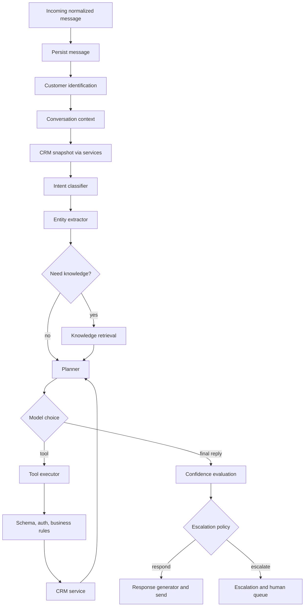

# AI Architecture

**Status:** Proposed design for a component that does not yet exist in the repository.  
**Goal:** An autonomous CRM agent with a bounded action set, not a chatbot that only drafts replies.

The orchestrator is ordinary application code. The language model is called at defined steps. Autonomy means the model may choose among registered tools. It does not mean the model may invent new actions.

## 1. Control of autonomy

| The model may | The backend decides |
| --- | --- |
| Propose an intent label | Whether that label is in the enum |
| Propose a tool name and arguments | Whether the tool exists, the arguments validate, and the policy allows it |
| Propose a confidence number | The final score after grounding and sensitivity rules |
| Propose reply wording | Whether that wording is allowed to claim a write happened |

Limits that are constants in `ai/escalation_policy.py`:

| Constant | Value | Meaning |
| --- | --- | --- |
| `MAX_TOOL_ROUNDS` | 3 | Planner calls per inbound message |
| `ACTION_CONFIDENCE_MIN` | 0.75 | Minimum final confidence to execute a mutating tool |
| `INFO_CONFIDENCE_MIN` | 0.55 | Minimum to send a knowledge answer |
| `MIN_CHUNK_SIMILARITY` | 0.75 | A chunk below this is not "grounding" |
| `MAX_FAILURES_BEFORE_ESCALATE` | 2 | Denied or failed tools on this turn |

Mutating tools are `update_customer`, `create_lead`, `update_lead`, `create_followup`, `create_support_task`. Read tools and `escalate_to_human` are not blocked by `ACTION_CONFIDENCE_MIN`. A low-confidence turn should still be able to escalate.

`send_message` is not chosen freely as a side effect. The orchestrator sends the final reply through the channel adapter. The `send_message` tool exists for the case where the planner must send an intermediate acknowledgement on a slow channel. In the website-chat MVP the orchestrator sends once at the end, and `send_message` is rejected with `TOOL_DENIED` unless `settings.allow_intermediate_send` is true. Default is false.

## 2. Pipeline



Intent classification and entity extraction are one structured LLM call, not two network round-trips. They are separate logical steps because they are stored as separate fields on `ai_actions`.

## 3. User message ingestion

`ChannelRouter` has already stored a `messages` row with `sender_type=customer` and linked a conversation. `handle_inbound` loads that row. If `conversations.ai_enabled` is false, the method returns without a model call and notifies the locking staff user.

The text sent to the model is the message content plus a fixed system prompt. Metadata such as channel and timestamp is included as labeled fields so the model can answer "you messaged us on the website yesterday" without trusting the customer to name the channel.

## 4. Intent classification

The classifier must return JSON matching this enum:

| Intent | Typical customer meaning |
| --- | --- |
| `faq` | Question answered from knowledge |
| `product_inquiry` | Asks about a package or service |
| `pricing` | Asks what something costs |
| `lead_request` | Wants to be contacted or buy |
| `profile_update` | Gives a new phone, email, or name |
| `follow_up_request` | Asks for contact at a time |
| `status_request` | Asks what is happening with their request |
| `complaint` | Expresses dissatisfaction |
| `refund_or_billing` | Money, charge, invoice, refund |
| `human_request` | Asks for a person |
| `other` | None of the above |

If parsing fails, intent is stored as `other` and the repair path in the LLD runs.

## 5. Entity extraction

Optional fields on the same JSON object:

| Field | Type | Use |
| --- | --- | --- |
| `person_name` | string | Provisional profile upgrade |
| `email` | string | Contact and identity |
| `phone` | string | Contact and identity |
| `product_name` | string | Must be matched to the published catalog list passed in the prompt |
| `requested_time` | ISO-8601 string | Follow-up scheduling |
| `channel_preference` | channel code | Follow-up channel |
| `sentiment` | `neutral`, `frustrated`, `angry` | Escalation priority, not a free-text diagnosis |

`product_name` is accepted only if it matches a name in the catalog snippet included with the prompt (`Starter`, `Standard`, `Premium` in the seed data, plus any published product titles). Otherwise the entity is dropped and the planner is told the product was not recognized.

## 6. Customer identification

This step is deterministic. `IdentityService.resolve(channel, external_identity)`:

1. Look up `customer_contacts` on `(channel, external_identity)`.
2. If found, use that customer.
3. If the message entities contain an email or phone that uniquely matches one customer, attach the new channel contact as unverified and use that customer. The reply asks the customer to confirm the match. Until a staff user or a second matching message confirms it, the AI may read the profile but may not run mutating tools except `create_support_task` and `escalate_to_human`.
4. If nothing matches, create a `provisional` customer and a contact for this channel.

The model does not choose the customer id. The executor overwrites any `customer_id` the model emits with the id from this step.

## 7. Conversation context retrieval

`ai_conversation_contexts` holds:

- `summary`: short text rewritten at the end of every third customer turn, and when the turn escalates.
- `rolling_facts`: JSON with product interest, preferred time, and contact details already confirmed.
- `last_intent`.

The prompt receives the summary, the facts, and the last 12 messages. Older text stays in PostgreSQL and is available to staff. It is not sent on every turn.

## 8. Customer history retrieval

`build_snapshot(customer_id)` calls services and returns:

- Profile fields the agent is allowed to see.
- Open leads: id, title, status, interest summary.
- Open follow-ups: id, time, channel, reason.
- Open tasks: title and status only.
- Last five journey events: type and timestamp, not free-text notes if `visibility=staff`.

There is no tool that returns "everything in the database."

## 9. Knowledge retrieval

Runs when intent is `faq`, `product_inquiry`, `pricing`, or `complaint` (policies), and also when the planner's first pass requests `search_knowledge`.

`Retriever.search(query, k=4)` returns chunks with similarity at least `MIN_CHUNK_SIMILARITY`. If none qualify, the prompt says that no approved article matched. The generator is then not allowed to state prices or policy rules from model memory.

Detail: [RAG-ARCHITECTURE.md](RAG-ARCHITECTURE.md).

## 10. Agent reasoning and planning

The planner receives:

- System instructions and the tool list.
- Intent, entities, snapshot, summary, retrieved chunks.
- Tool results from earlier rounds in this turn.

It must return either:

```json
{ "type": "tool", "name": "create_lead", "arguments": { } }
```

or:

```json
{ "type": "final", "reply": "...", "confidence": 0.0 }
```

`confidence` is the model's estimate that the reply is correct and complete, from 0 to 1.

The system instruction tells the model to use a tool when a CRM fact or write is required, and to refuse actions that are not tools. Those sentences are guidance. The executor is the control.

## 11. Tool selection

Only names in the registry are selectable. The provider's tool-calling format is translated inside `LLMClient` so the rest of the code sees the JSON above. If the provider returns a tool call and text, the tool call wins and the text is discarded for that round.

## 12. Tool execution

`ToolExecutor.execute(turn, call)`:

1. Reject unknown names with `unknown_tool`.
2. Validate arguments with the tool's Pydantic model.
3. Inject `customer_id`, `conversation_id`, and `actor=ai_agent` from the turn. Drop any model-supplied customer id.
4. Check `authorize(tool, turn)`.
5. Compute idempotency key: SHA-256 of `conversation_id`, inbound `message_id`, tool name, and canonical JSON arguments.
6. If an `ai_actions` row with that key already succeeded, return the stored output.
7. Call the service method.
8. Write `ai_actions` with status `success`, `denied`, or `failed`.

Services apply the business rules in the LLD again. Defense is duplicated on purpose so a bug in the executor still cannot bypass lead transition rules.

## 13. Result validation

After a mutating tool returns:

- The result must include the record id.
- The executor re-reads the record through the service and checks the changed field. A mismatch is `failed`, not success.
- The final reply may mention a write only if this turn has a matching successful `ai_actions` row. A small template check looks for phrases such as "I have created" and blocks the send if the phrase is present without a success row. The turn then escalates with `ungrounded_claim`.

## 14. Response generation

The final reply is the planner's `reply` field after the claim check. It is not a separate creative pass. This keeps the words tied to the same context that chose the tools.

Tone rules in the prompt:

- Plain language, short.
- Do not invent prices, dates, or staff names.
- If escalating, say that a person will take over. Do not promise a refund or a time the SLA does not support.

The outbound message is stored with `sender_type=ai_agent` and sent through `adapter.send`.

## 15. Confidence evaluation

`final_confidence` starts at the model number, then:

| Condition | Adjustment |
| --- | --- |
| Informational reply and no chunk met similarity | Cap at 0.40 |
| Mutating tool failed or was denied | Cap at 0.50 |
| Intent is `refund_or_billing` or `human_request` | Cap at 0.30 |
| All mutating tools this turn re-read successfully | Leave as returned, but not above 0.95 |
| Entity `sentiment=angry` | Cap at 0.45 |

The cap is what the policy sees. The raw model number is still stored.

## 16. Escalation decision

`EscalationPolicy.decide(turn) -> respond | escalate`.

Escalate when any of these is true:

| Code | Rule |
| --- | --- |
| `low_confidence` | Intent needs an answer or action and `final_confidence` is below the threshold for that kind of turn |
| `human_requested` | Intent is `human_request`, or the text contains an explicit ask that the classifier marked |
| `sensitive_complaint` | Intent is `complaint` and sentiment is `angry`, or the customer alleges harm, fraud, or legal action. The classifier's intent is the trigger used by code; staff can correct it |
| `billing_requires_human` | Intent is `refund_or_billing`. The agent may explain the published refund policy from a chunk, then must escalate. It cannot create a refund |
| `tool_not_permitted` | The planner asked for a tool that does not exist, or a denied mutation the customer still needs |
| `repeated_failure` | Two tool failures or denials on this turn and the customer goal is unmet |
| `identity_conflict` | Email or phone matches more than one customer |
| `policy_approval` | Lead status requested is `converted`, `lost`, or `unqualified` |

Do not escalate when:

- The question was answered from a chunk above the similarity floor and confidence is at least `INFO_CONFIDENCE_MIN`.
- A follow-up or lead was created successfully and the reply only confirms that record.
- The customer is chatting about product differences and no write is required.

Priority mapping:

| Situation | Priority |
| --- | --- |
| Billing, fraud, legal, angry complaint | urgent |
| Human requested, repeated failure | high |
| Low confidence, identity conflict | medium |
| Staff review of an AI lead | low |

## 17. Human handoff

On escalate:

1. `EscalationService.open` creates or returns the active escalation.
2. Conversation `ai_enabled` becomes false and status becomes `pending_human`.
3. Assignees are not picked by the model. The service notifies all supervisors for `urgent` and `high`. For `medium` and `low` it notifies the shared queue.
4. The customer receives one sentence that a staff member will continue the conversation.
5. The next inbound message does not enter the orchestrator until a staff user releases the conversation.

Outcome storage is the escalation resolution note and the journey event. See the LLD. There is no training loop in the prototype.

## 18. Decision policy summary

The planner is prompted with these questions. Code checks the same conditions after the plan returns.

1. Can I answer this from retrieved chunks or tool results?
2. Do I need the CRM snapshot? It is already loaded. Do not call a tool to re-fetch the same snapshot.
3. Do I need a write? If yes, which single tool?
4. Is that tool in the registry? If not, escalate.
5. Is final confidence high enough for that write or that answer?
6. Does the policy force a human?

`get_customer` and `get_conversation_history` exist so a later turn, or a staff-triggered "ask the agent" action, can refresh context. On the hot path the orchestrator prefetches them. If the planner calls them anyway, they count toward `MAX_TOOL_ROUNDS`.

## 19. Tool catalog

Shared conventions:

- Actor is always `ai_agent`.
- Authorization is the tool allow-list plus the service rules. There is no staff permission that widens the AI at runtime.
- Failure behavior: return a structured error to the planner, persist `ai_actions`, do not throw past the orchestrator unless the database is unavailable. A database outage fails the turn and escalates with `data_store_unavailable`.

### get_customer

| | |
| --- | --- |
| Purpose | Read the linked customer's profile and open lead titles |
| Input | `{ "include_contacts": false }` |
| Output | `{ "customer_id", "full_name", "status", "primary_email", "primary_phone", "preferred_channel", "open_leads": [] }` |
| Authorization | Turn must already be bound to that customer |
| Validation | `include_contacts` defaults false. Contacts returned only as the channel and a masked handle |
| Failure | Unknown customer returns `not_found`. The turn escalates with `identity_conflict` if the bind is missing |

### update_customer

| | |
| --- | --- |
| Purpose | Apply an allow-listed profile change the customer just stated |
| Input | `{ "full_name"?: string, "primary_email"?: string, "primary_phone"?: string, "preferred_channel"?: string, "note"?: string, "add_tags"?: string[] }` |
| Output | `{ "customer_id", "updated_fields": [] }` |
| Authorization | Customer bound. If the match is unverified, deny |
| Validation | Email format, E.164-like phone, channel code, tags from vocabulary, note max 500 characters. At least one field |
| Failure | `TOOL_DENIED` or `VALIDATION_ERROR` returned to the planner |

### create_lead

| | |
| --- | --- |
| Purpose | Open a sales lead when the customer shows buying interest |
| Input | `{ "title": string, "product_name"?: string, "interest_summary": string, "source_channel": string }` |
| Output | `{ "lead_id", "status": "new", "created": true }` or `{ "lead_id", "created": false, "reason": "existing_open_lead" }` |
| Authorization | Verified or provisional customer with a name or a contact handle. Provisional customers may get a lead because capturing interest is the point of the tool. Mutating confidence rule applies |
| Validation | Title 3–120 chars. `product_name` must match the catalog if present. `source_channel` must equal the turn channel |
| Failure | Validation error returned. Duplicate open lead updates interest and returns `created: false` |

### update_lead

| | |
| --- | --- |
| Purpose | Move an AI-allowed transition or refresh the interest summary |
| Input | `{ "lead_id": string, "status"?: string, "interest_summary"?: string }` |
| Output | `{ "lead_id", "status" }` |
| Authorization | Lead must belong to the bound customer. Status must be an AI-allowed transition |
| Validation | UUID. Status enum. Summary max 1000 characters |
| Failure | `TOOL_DENIED` for `converted`, `lost`, `unqualified`, or a lead owned by another customer |

### create_followup

| | |
| --- | --- |
| Purpose | Schedule a staff contact |
| Input | `{ "lead_id"?: string, "scheduled_at": string, "channel": string, "reason": string }` |
| Output | `{ "followup_id", "scheduled_at", "status": "scheduled" }` |
| Authorization | Verified identity, or provisional with email or phone. Confidence rule applies |
| Validation | Future timestamp within 30 days. One open AI follow-up per lead per day. Reason max 500 characters |
| Failure | `FOLLOWUP_REJECTED` returned to the planner with the rule code |

### get_conversation_history

| | |
| --- | --- |
| Purpose | Read recent messages when the prefetched window is not enough |
| Input | `{ "limit": 12 }` |
| Output | `{ "messages": [{ "direction", "sender_type", "content", "created_at" }] }` |
| Authorization | Bound conversation only |
| Validation | Limit 1–30 |
| Failure | `not_found` if the conversation was deleted, which staff cannot do in the MVP. Treat as escalate |

### search_knowledge

| | |
| --- | --- |
| Purpose | Retrieve published chunks |
| Input | `{ "query": string }` |
| Output | `{ "chunks": [{ "document_title", "content", "similarity" }] }` |
| Authorization | Published documents only |
| Validation | Query 3–300 characters |
| Failure | Empty list is a successful result. The generator must not invent policy |

### create_support_task

| | |
| --- | --- |
| Purpose | Leave internal work after a case the AI cannot close |
| Input | `{ "title": string, "description": string, "priority": "low" \| "medium" \| "high" }` |
| Output | `{ "task_id", "status": "open" }` |
| Authorization | Bound customer. No assignee in the input schema |
| Validation | Title 3–140 chars. Description max 2000. Priority enum without `urgent` |
| Failure | Validation error returned. The planner should escalate if the customer is waiting |

### escalate_to_human

| | |
| --- | --- |
| Purpose | Hand the conversation to staff |
| Input | `{ "reason_code": string, "reason_detail": string, "priority": "low" \| "medium" \| "high" \| "urgent" }` |
| Output | `{ "escalation_id", "status": "open" }` |
| Authorization | Always allowed for the bound conversation. Priority `urgent` is accepted only if the policy also classified the turn as billing, fraud, legal, or angry complaint. Otherwise the service downgrades to `high` |
| Validation | `reason_code` must be one of the policy codes. Detail max 1000 characters |
| Failure | If an active escalation exists, return that id with `created: false` |

### send_message

| | |
| --- | --- |
| Purpose | Optional intermediate outbound message |
| Input | `{ "content": string }` |
| Output | `{ "message_id" }` |
| Authorization | Denied unless `allow_intermediate_send` is true |
| Validation | Content 1–2000 characters. The ungrounded-claim check applies |
| Failure | `TOOL_DENIED` by default. Final replies use the orchestrator send path, not this tool |

## 20. Worked decision examples

**Sales request.** Intent `lead_request` plus `follow_up_request`, product `Premium`, time tomorrow 14:00. Confidence 0.86. Tools: `search_knowledge`, `create_lead`, `create_followup`. Policy: respond. This is demo scenario 1 in [DEMO-SCENARIOS.md](DEMO-SCENARIOS.md).

**Refund demand.** Intent `refund_or_billing`. The planner may call `search_knowledge` and then must call `escalate_to_human` with `billing_requires_human`. If it tries to reply that a refund was issued, the claim check blocks the send.

**FAQ.** Intent `faq`, one chunk at 0.82, no mutating tool, confidence 0.8. Policy: respond. No escalation.
