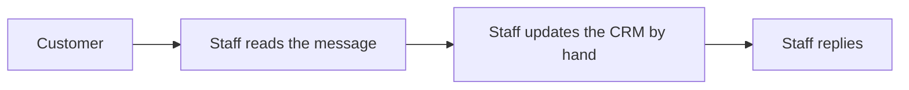
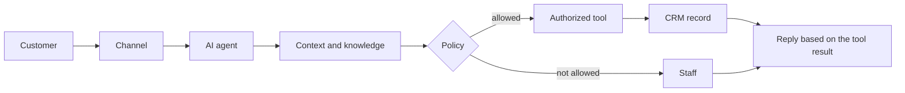

# Why the AI Agent Is in the Architecture

A traditional CRM already stores customers and lets staff type notes. This project is worth building only if the agent changes the path between a customer message and a CRM record, under rules a person can inspect.

The agent does not replace staff. It prepares records and answers from approved text. Staff own refunds, lost deals, conversions, and any conversation they take over.

## Paths

**Traditional**

**This system**

The middle of the second path is the project: context, a decision, a tool, or a person.

## What the AI contributes

| Capability | What the code actually does | What it does not do |
| --- | --- | --- |
| Intent understanding | Labels the turn with a fixed enum stored on `ai_actions` | It does not freely classify into tables it invents |
| Context awareness | Loads the bound customer, open leads, and a short summary before planning | It does not search the whole database |
| Decision support | Policy chooses respond or escalate using confidence, intent, and tool results | It does not override a billing rule because the model is confident |
| Automation | Creates leads, schedules follow-ups, updates allow-listed fields, opens tasks | It does not close sales or delete people |
| Tool use | Chooses among registered functions. The executor validates | It does not emit SQL |
| RAG | Answers prices and policies from published chunks | It does not treat model memory as the price list |
| Follow-up automation | Writes a `follow_ups` row and later notifies staff when it is due | It does not mark the follow-up complete or pretend the meeting happened |
| Human escalation | Opens a queue item and disables itself | It does not pick a favorite employee or resolve the case |

## Concrete difference in the two demo sentences

"I am interested in your premium package. Can someone contact me tomorrow afternoon?"

- Traditional: the message waits until a person reads it, creates the lead, and types a follow-up.
- This prototype: the same person still owns the relationship, but the lead and the follow-up exist before they open the inbox, and the customer already has a confirmed time that matches the row.

"I was charged incorrectly and I want a refund."

- Traditional: a person must handle it.
- This prototype: a person still must handle it. The agent’s job is to recognize that quickly, keep a transcript, and not invent a refund. That refusal is part of the AI design, not a missing feature.

## Decision support for staff

The side panel shows intent, tools, and confidence so the staff member starts from a draft record instead of an empty form. They can mark the lead lost or converted. The agent’s earlier steps stay in the audit trail.

## Cost of the approach

The team accepts model latency, a provider key, and evaluation work. In return, the course project can show an autonomous step that a keyword bot cannot show: choosing a tool, failing a policy check, and leaving an audit row either way.

If those tool rows are not in the demo, the AI has not contributed and the system is a traditional CRM with generated text. The MVP definition treats that outcome as failure.
