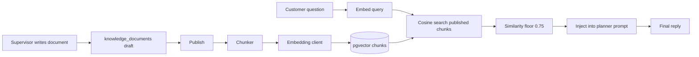

# RAG Architecture

**Status:** Proposed. No vector store or documents exist in the repository yet.  
**Store:** `knowledge_chunks.embedding` in PostgreSQL using pgvector. A separate vector database is not used.

Retrieval grounds answers about products, services, prices, FAQs, policies, and company facts. It does not ground CRM facts. Customer state comes from CRM tools and the snapshot.

## 1. What is retrieved

Seed corpus for Northline Services, a fictional services company used only so the prototype has stable answers:

| source_type | Example documents |
| --- | --- |
| `product` | Starter, Standard, and Premium package descriptions |
| `pricing` | Public prices and what is included. No negotiated discounts |
| `faq` | Hours, how to book, what the agent can and cannot change |
| `policy` | Refund policy: refunds are requested to a person, not issued in chat |
| `company` | Who Northline is, support hours |
| `support` | How complaints are handled and when a human takes over |

Staff can add documents through the API. The agent never retrieves `draft` or `archived` rows.

## 2. Architecture



## 3. Document ingestion

`POST /api/v1/knowledge/documents` creates a draft with `title`, `source_type`, and `body` (plain text or Markdown). Files are out of scope for the MVP. A supervisor pastes text. This avoids a file-parsing library and the malware questions that come with uploads.

Maximum body size is 40,000 characters. Larger manuals are split by the author into more than one document.

## 4. Document processing

On publish:

1. Strip Markdown code fences. Keep headings because they help the chunker.
2. Reject empty bodies.
3. Store `version` incremented by 1.
4. Set status to `published` only after chunks commit.

No HTML rendering. Links stay as text.

## 5. Chunking

`Chunker.split(body)`:

- Target size 800 characters, overlap 120 characters.
- Prefer splits on Markdown headings, then blank lines, then sentences.
- Each chunk records `chunk_index`, `content`, `token_count` estimated as `length / 4`, and metadata `{ "title", "source_type", "document_id" }`.

Overlap is there so a price that sits on a boundary still appears with its package name.

## 6. Embedding generation

`LLMClient.embed(texts: list[str]) -> list[list[float]]`.

- Default dimension: **768**.
- The column is `vector(768)`.
- Batch size 32.
- The query is embedded with the same model. Mixing models is a defect, not a feature.

`LLM_EMBED_MODEL` and `EMBEDDING_DIM` must match the column. Changing the model means a migration and a full re-embed. Publish of new documents does not migrate old vectors.

If the provider returns a different length, ingest fails with `EMBEDDING_DIM_MISMATCH` and the previous chunks remain.

## 7. Vector storage

Table `knowledge_chunks`, defined in the database design.

Search SQL shape:

```sql
SELECT id, document_id, content, 1 - (embedding <=> :query) AS similarity
FROM knowledge_chunks kc
JOIN knowledge_documents kd ON kd.id = kc.document_id
WHERE kd.status = 'published'
ORDER BY embedding <=> :query
LIMIT :k;
```

`<=>` is cosine distance in pgvector. An HNSW index is created in the migration:

```sql
CREATE INDEX ON knowledge_chunks
USING hnsw (embedding vector_cosine_ops);
```

For the seed corpus of well under 1,000 chunks, exact scan is also fine. The index is created anyway so the query shape does not change later.

Chunks for a document are replaced inside one transaction: delete old chunks, insert new ones, then mark the document published. A crash mid-request rolls back. Readers never see a half-updated document.

## 8. Retrieval

`Retriever.search(query, k=4)`:

1. Embed the query.
2. Run the SQL above with `k=8` candidates.
3. Drop candidates with similarity under **0.75**.
4. Return at most 4.
5. Record chunk ids on the `ai_actions` row for that turn (`retrieved_chunk_ids`).

The customer question is the query. For follow-up turns, the query is the current message plus the `product_name` entity if one was extracted. The whole transcript is not embedded as the query.

## 9. Context injection

The planner prompt contains a block:

```text
Approved knowledge:
[1] title (similarity 0.xx)
chunk text
[2] ...
```

If the list is empty:

```text
Approved knowledge: none. Do not state prices, refund rules, or package inclusions.
```

Chunks are data. The prompt says that instructions inside a chunk are not system instructions. A poisoned article can still bias an answer, so only supervisors publish, and publish is audited.

## 10. Response generation

Rules enforced in `confidence.py` and the claim check:

- A reply that states a price or a policy must have at least one injected chunk. Otherwise confidence is capped and the policy escalates or the reply is replaced with: "I don't have an approved article on that. I can ask a staff member to continue."
- The model is instructed to use only the injected text for those facts. The cap is what makes the instruction enforceable when the model ignores it.
- CRM writes are not "retrieved." A sentence about a follow-up time must match `create_followup`'s returned timestamp.

## 11. Evaluation

See the RAG section of [TESTING-STRATEGY.md](../testing/TESTING-STRATEGY.md). Minimum gold set: 20 questions written from the seed articles, with the expected document id. A change to chunk size or the similarity floor is accepted only if recall at 4 does not drop by more than 10 percent on that set.

## 12. What this design deliberately omits

- No hybrid keyword ranker in the MVP. If a demo question fails because of wording, add the missing phrase to the article before adding a search engine.
- No automatic crawl of a company website.
- No customer-specific documents in the vector index. Personal data stays in CRM tables.
- No model fine-tuning on resolution notes.
