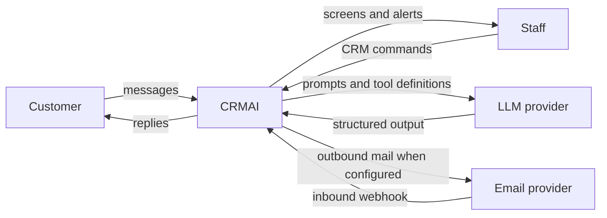
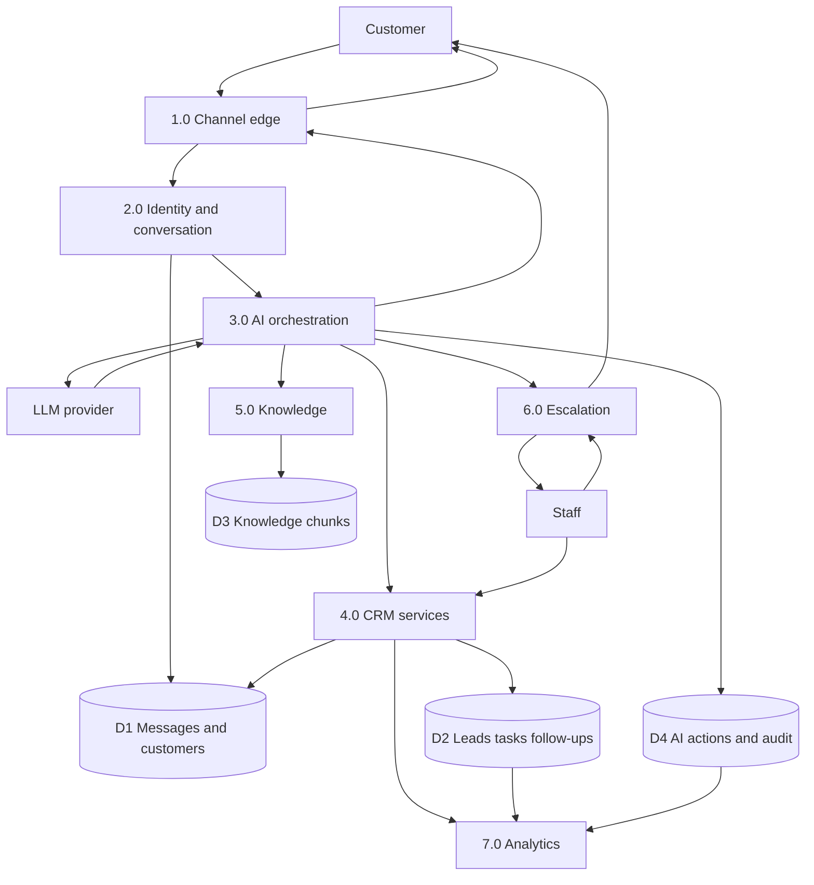
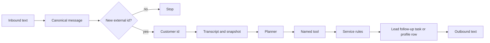
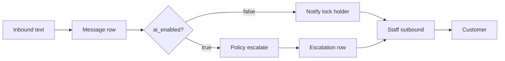
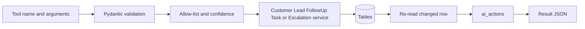
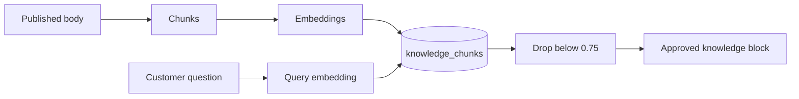
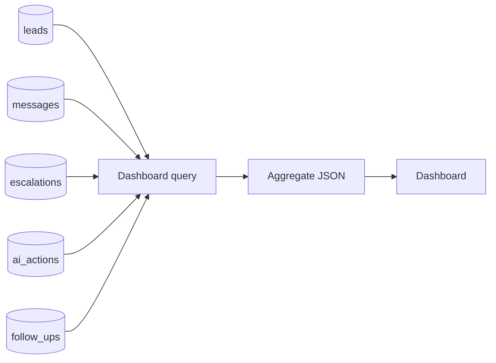

# Data Flow

The system has one store, PostgreSQL. Arrows are data movement, not deployment nodes. External providers receive only what that adapter must send.

## Level 0

WhatsApp, Facebook, Instagram, and voice providers are the same shape as Mail when a token exists. Until then they are not level-0 externals. The simulator is part of P1, enabled only in development.

## Level 1

## Level 2 — Customer to channel to AI to CRM

The planner never receives a connection string. The only data leaving toward the LLM is the prompt built from the snapshot, the recent transcript, and retrieved chunks.

## Level 2 — Customer to channel to human

## Level 2 — AI to CRM tools

Denied and failed branches still write `ai_actions` and return to the planner. They do not write the CRM table.

## Level 2 — Knowledge to RAG to AI

Draft text does not enter this flow.

## Level 2 — CRM to analytics

The query reads copies of the operational tables. Nothing is written back. Message content is not selected by these queries, only counts and timestamps.
