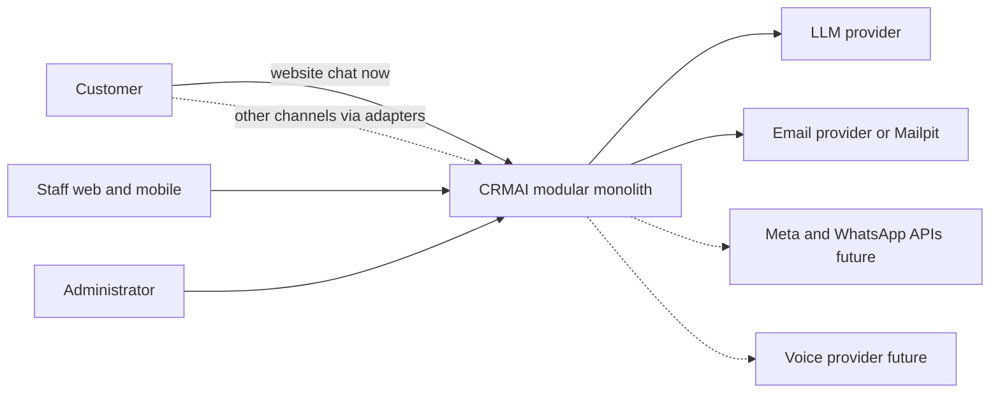
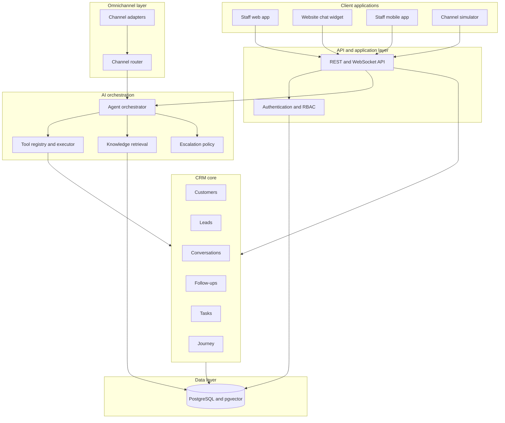
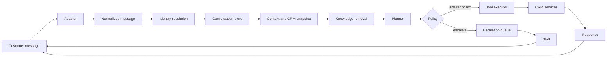
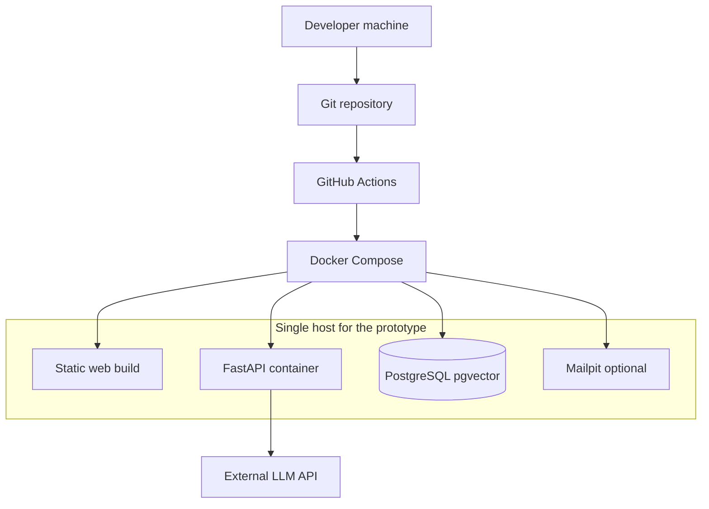

# High-Level Design

**Project:** Autonomous AI Agent for Omnichannel Customer Relationship Management  
**Document status:** Proposed architecture  
**Repository state at assessment:** Empty. No application source, schema, API, tests, or deployment configuration existed. Nothing in this document describes a running implementation.

## 1. Introduction

This system is a functional prototype of an AI-powered CRM. Customers reach the business through communication channels. An omnichannel gateway turns those messages into one internal format. An autonomous AI agent reads the customer context, retrieves approved knowledge, and performs a small set of authorized CRM actions. When the request is sensitive, uncertain, or outside that set, the agent escalates to a human staff member.

The AI agent is not a chat widget placed beside a traditional CRM. It is the component that decides whether to answer, call a CRM tool, or hand the case to a person. The backend, not the model, authorizes and validates every tool call.

This design targets a four-person university team and a demonstrable prototype. It is a modular monolith: one deployable backend with clear modules, one relational database, one web application, and a staff mobile application.

### Assessment before design

| Area | Finding |
| --- | --- |
| Frontend, backend, database, auth, APIs | Not present |
| AI / LLM code | Not present |
| Models, services, integrations | Not present |
| Tests, CI, deployment, environment files | Not present |
| Reusable implementation | None. The architecture is greenfield |
| Technical debt in code | None, because there is no code |

Gaps against the proposal are therefore the entire system. The design below covers those gaps without introducing microservices, a separate vector database, or a workflow engine.

## 2. System objectives

1. Keep one customer profile even when the person writes from more than one channel.
2. Accept messages through a single internal pipeline, starting with a real website chat channel.
3. Let the AI agent create and update leads, update allowed customer fields, schedule follow-ups, and create tasks.
4. Record a customer journey timeline from first contact through resolution.
5. Escalate cases that fail an explicit decision policy.
6. Give staff a web application and a smaller mobile application to handle customers, leads, and escalations.
7. Show prototype analytics from data the CRM already stores.
8. Expose a versioned HTTP API so channels and clients share one application core.

## 3. Scope

### In scope for the prototype

- Staff authentication and role-based access.
- Customers, contacts, leads, conversations, messages, follow-ups, tasks, escalations, notifications, audit records.
- Website chat as a live channel.
- An adapter interface for WhatsApp, Facebook, Instagram, email, and voice, plus a channel simulator so those adapters can be demonstrated without vendor accounts.
- Email as the second real transport when time allows (SMTP outbound and an inbound webhook, with Mailpit in development).
- AI orchestration with intent and entity extraction, retrieval-augmented answers, controlled tools, confidence checks, and escalation.
- A knowledge base of products, services, pricing, FAQs, and policies for a fictional seed company, Northline Services.
- Staff web UI and a staff mobile UI.
- Journey timeline and a dashboard of prototype metrics.

### Out of scope

- Live WhatsApp, Facebook, Instagram, or telephony provider contracts. Those adapters exist in code as interfaces and simulator-backed implementations. Connecting a real provider is a later integration, not a claim that the API is already available.
- Payments, refunds, invoicing, and inventory.
- Multi-tenant SaaS isolation. The prototype is a single organization.
- Autonomous deletion of CRM records, user administration by the AI, or free-form SQL.
- Kubernetes, message buses, and a separate AI microservice.

## 4. Functional requirements

| ID | Requirement | Architectural response |
| --- | --- | --- |
| FR-01 | Unified customer profiles | `customers` plus `customer_contacts` keyed by channel identity |
| FR-02 | Omnichannel communication | Channel adapters normalize into one message model. Website chat is live in the MVP. Other channels share the same pipeline |
| FR-03 | Autonomous CRM operations | AI tools: create/update lead, update customer, create follow-up, create task |
| FR-04 | Customer journey tracking | `customer_interactions` written by CRM services, including AI-originated events |
| FR-05 | AI-based decision support | Orchestrator chooses answer, tool, or escalation using policy plus model output |
| FR-06 | Human escalation | Escalation record, queue, assignment, conversation lock, resolution |
| FR-07 | Web application | React staff application and a public website chat widget |
| FR-08 | Mobile application | Expo staff application for inbox, customers, follow-ups, and escalations |
| FR-09 | CRM analytics | Read models over leads, messages, AI actions, and escalations |
| FR-10 | API integrations | Versioned REST API and outbound adapters. External providers are dependencies, not built-in services |

## 5. Non-functional requirements

Measurable targets are in [NFR.md](../requirements/NFR.md). Summary:

- Staff API reads: p95 under 500 ms on the lab dataset.
- AI reply with no tool: p95 under 8 seconds. With one tool round: p95 under 15 seconds.
- Availability target for demos and supervised lab use: 95 percent, not a commercial SLA.
- AI cannot issue SQL. Every mutation goes through a named tool and a policy check.
- One backend process is an acceptable deployment. Horizontal scale is a later step, not a prototype requirement.

## 6. Actors

| Actor | Type | What they do |
| --- | --- | --- |
| Customer | Human, external | Sends inquiries and receives replies |
| Staff agent | Human, role `agent` | Handles assigned conversations, leads, tasks, and follow-ups |
| Supervisor | Human, role `supervisor` | Assigns escalations, reads analytics, publishes knowledge |
| Administrator | Human, role `admin` | Manages users and configuration |
| AI Agent | Software principal `ai_agent` | Plans and requests tools. It is not a row a person can log in as |
| Channel provider | External system | Delivers or accepts messages when that channel is connected |

## 7. System context

Solid lines are in the MVP. Dashed lines are designed and simulated, or deferred until an external account exists.

## 8. Architectural principles

1. **One write path for CRM data.** UI, webhooks, and the AI agent call the same application services. The model never receives a database connection.
2. **Normalize at the edge.** Channel-specific payloads die inside adapters.
3. **Policy beside the model.** Confidence and escalation rules are code. The model proposes; the policy decides.
4. **Least agency.** The tool list is an allow-list. Refunds, deletes, role changes, and record merges are absent from that list.
5. **Audit the decision.** Each agent turn stores intent, tools, confidence, and the escalation decision without storing secrets or full payment data.
6. **Replaceable providers.** LLM, email, and future messaging vendors sit behind interfaces.
7. **Prototype honesty.** A simulator channel is labeled as a simulator. Documents do not describe unconnected vendor APIs as available.

## 9. Architecture style

**Modular monolith.**

Modules live in one FastAPI process and share one PostgreSQL database. They communicate through in-process service calls, not network hops. This is the right style because the team has four people, the data is highly relational, and the AI must stay in the same transaction boundary as the CRM action it requests.

Microservices were rejected. A separate AI service would duplicate auth, customer reads, and failure handling for no prototype benefit. See [ADR-001](../adr/ADR-001-architecture-style.md).

## 10. Overall system architecture

## 11. Major components

| Component | Responsibility |
| --- | --- |
| Staff web app | CRM work: inbox, profiles, leads, journey, knowledge admin, analytics |
| Website chat widget | Public customer entry channel |
| Staff mobile app | Inbox, search, follow-ups, escalations, notifications |
| API layer | Versioned REST `/api/v1` and authenticated WebSockets |
| Auth and RBAC | Login, refresh tokens, role permissions |
| CRM core | Customers, leads, conversations, follow-ups, tasks, journey events |
| Omnichannel layer | Adapters, normalization, identity hooks, deduplication |
| AI orchestrator | The controlled loop from message to answer, tool, or escalation |
| Tool executor | Schema validation, authorization, idempotency, service calls |
| Knowledge / RAG | Ingest, chunk, embed, retrieve |
| Escalation | Queue, priority, assignment, lock, resolve |
| Notifications | In-app records and optional email |
| Analytics | Aggregate queries for the dashboard |
| PostgreSQL | System of record, including embeddings |

## 12. Component responsibilities

Responsibilities are detailed in [LLD.md](LLD.md) and [COMPONENT-MATRIX.md](COMPONENT-MATRIX.md). The rule that matters at this level:

- **Adapters** translate and verify webhooks. They do not create leads.
- **CRM services** enforce business rules for every caller, including the AI.
- **The orchestrator** selects tools. It does not commit data itself.
- **The tool executor** is the only AI path into CRM services.
- **The policy module** can override a model that wants to answer a refund request.

## 13. External systems

| System | Role in this project | Status |
| --- | --- | --- |
| LLM chat API | Intent, entities, planning, response wording | Required dependency. Provider is configured, not hard-coded |
| Embedding API | Vectors for knowledge chunks | Same provider family by default |
| PostgreSQL | Database | Required, run via Docker Compose locally |
| Mailpit or SMTP | Email adapter in development and, later, a real mailbox | Dev dependency for the email channel. Not required for the website-chat MVP |
| Meta WhatsApp, Facebook, Instagram APIs | Future channel transports | Not integrated. Simulator only until credentials and app review exist |
| Telephony / speech vendor | Future voice transport | Not integrated. Voice adapter accepts a transcript |
| Push notification service | Optional mobile push | In-app notifications are the prototype path. Push is a later enhancement |

## 14. Data flow

Level 0 and level 1 diagrams are in [DATA-FLOW.md](DATA-FLOW.md).

## 15. AI architecture

The agent runs a bounded loop:

1. Persist the inbound message.
2. Resolve the customer deterministically from channel identity.
3. Load the recent transcript, the stored summary, and a CRM snapshot through services.
4. Ask the model for intent and entities as structured output.
5. Retrieve knowledge chunks when the intent is informational or about products, pricing, or policy.
6. Ask the model for the next action: reply text or one tool call, using only registered tools.
7. Validate and authorize the tool, execute it, and append the result.
8. Repeat for at most three tool rounds.
9. Score confidence with model self-report plus rules (grounding, tool success, sensitive intent).
10. Apply the escalation policy.
11. Send the reply or open an escalation. Write `ai_actions` and a journey event.

Full design: [AI-ARCHITECTURE.md](../ai/AI-ARCHITECTURE.md). Retrieval: [RAG-ARCHITECTURE.md](../ai/RAG-ARCHITECTURE.md).

## 16. Security architecture

- Staff use email and password. Passwords are hashed with bcrypt.
- Access tokens last 15 minutes. Refresh tokens last 7 days and are stored only as hashes.
- RBAC is enforced on every staff route.
- The public chat route uses a separate widget key, origin checks, and rate limits. It cannot call CRM admin APIs.
- Webhooks are verified with a shared secret per channel. Simulator requests are disabled outside development and test.
- Tool authorization is independent of anything the model writes in the prompt.
- Prompt-injection text inside a customer message is treated as untrusted data, not as instructions to expand tool rights.

Detail: [SECURITY-DESIGN.md](../security/SECURITY-DESIGN.md).

## 17. Integration architecture

Every channel implements `ChannelAdapter`: receive, validate, normalize, identify, send. The orchestrator depends on the canonical message, not on WhatsApp or email payloads.

The LLM implements `LLMClient`: structured completion, tool-call completion, embeddings. Switching provider changes the adapter and environment variables. It does not change CRM services.

Detail: [OMNICHANNEL-INTEGRATION.md](../integrations/OMNICHANNEL-INTEGRATION.md).

## 18. Deployment architecture

Development, test, and production differ by environment variables and by whether the channel simulator is enabled. There is no Kubernetes. Detail: [DEPLOYMENT-ARCHITECTURE.md](../deployment/DEPLOYMENT-ARCHITECTURE.md).

## 19. Scalability considerations

The prototype is expected to hold thousands of messages and dozens of concurrent staff users, which is enough for a university demonstration.

- Indexes are defined for customer search, inbox lists, and webhook deduplication.
- Conversation summaries keep model prompts bounded as threads grow.
- Retrieval uses a vector index after the knowledge base exceeds a few hundred chunks. Below that, exact search is acceptable.
- The follow-up scheduler runs inside the API process. That is safe for one instance. A second API instance must not run a second scheduler; move the scheduler to a single worker first.

These are capacity notes, not a scaling program.

## 20. Reliability considerations

- Inbound messages are stored before the model is called. A model failure still leaves the customer message in the inbox.
- Webhook duplicates are ignored using `(channel, external_message_id)`.
- Tool calls carry an idempotency key so a retry does not create two leads for one message.
- If the LLM times out, the turn escalates or returns a staff-visible failure. It does not invent a CRM result.
- Database backups are daily dumps in the production-like environment. The lab environment can be rebuilt from migrations and seed data.

## 21. Observability

Structured logs include request id, conversation id, customer id, intent, tool name, tool status, confidence, and escalation decision. They exclude message bodies, tokens, and password hashes. Detail: [OBSERVABILITY.md](OBSERVABILITY.md).

## 22. Architectural assumptions

1. The repository was empty at the time of this design. Any future code should follow this package layout rather than the reverse.
2. The prototype serves one fictional organization, Northline Services, so knowledge-base demos have concrete products and policies.
3. Students can obtain an API key for one LLM provider. Without a key, AI scenarios cannot be demonstrated; the rest of the CRM can still run.
4. Customers using website chat can be identified by a stored cookie/session and, when they give it, by email or phone.
5. Staff count is small. A shared escalation queue is enough. No workforce-management product is required.
6. "Voice calls" in the prototype means a transcript entering the voice adapter, not a live phone switch.
7. The four team members map to the ownership in [COMPONENT-MATRIX.md](COMPONENT-MATRIX.md). Names were not present in the repository.

## 23. Architectural constraints

- Four people and an academic calendar. The MVP must be demonstrable before extra channels.
- No budget assumed for paid vector databases, SMS gateways, or Meta business verification.
- The AI principal cannot hold a staff password or a database URL in the prompt.
- Embedding dimension is fixed at 768 unless a migration rewrites `knowledge_chunks`.
- Single PostgreSQL instance. No cross-region requirement.

## 24. Risks

| Risk | Why it matters | Mitigation |
| --- | --- | --- |
| LLM cost or quota | Demos fail on the day | Small model, max tool rounds, cached embeddings, seed scenarios that are short |
| Hallucinated CRM claims | Agent says a lead was created when it was not | Reply text for actions must quote tool results. If no tool result exists, the reply cannot claim the write |
| Prompt injection | Customer text tries to trigger refunds or data dumps | Tools are not expanded by prompt text. Sensitive intents hit the policy |
| Channel scope creep | Team spends the project on WhatsApp approval | Website chat is the MVP channel. Others stay behind the adapter |
| Identity mistakes | Two people merged, or one person split | Automatic match only on verified email or phone. Otherwise create a provisional profile and ask |
| Empty-repo drift | Later code ignores the docs | Roadmap phases map to modules; API and schema names are normative |

## 25. Future enhancements

- Connect one real Meta or email provider after the MVP demo.
- Mobile push via a single push provider.
- Supervisor UI to edit the escalation threshold without a deploy.
- Optional Redis for rate limits and a dedicated worker for the scheduler.
- Multi-organization tenancy, only if the project is extended beyond the course.
