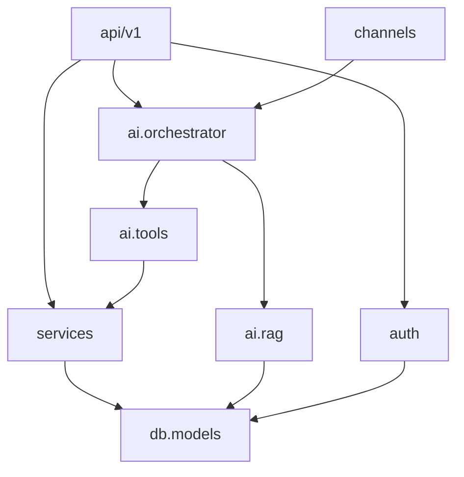
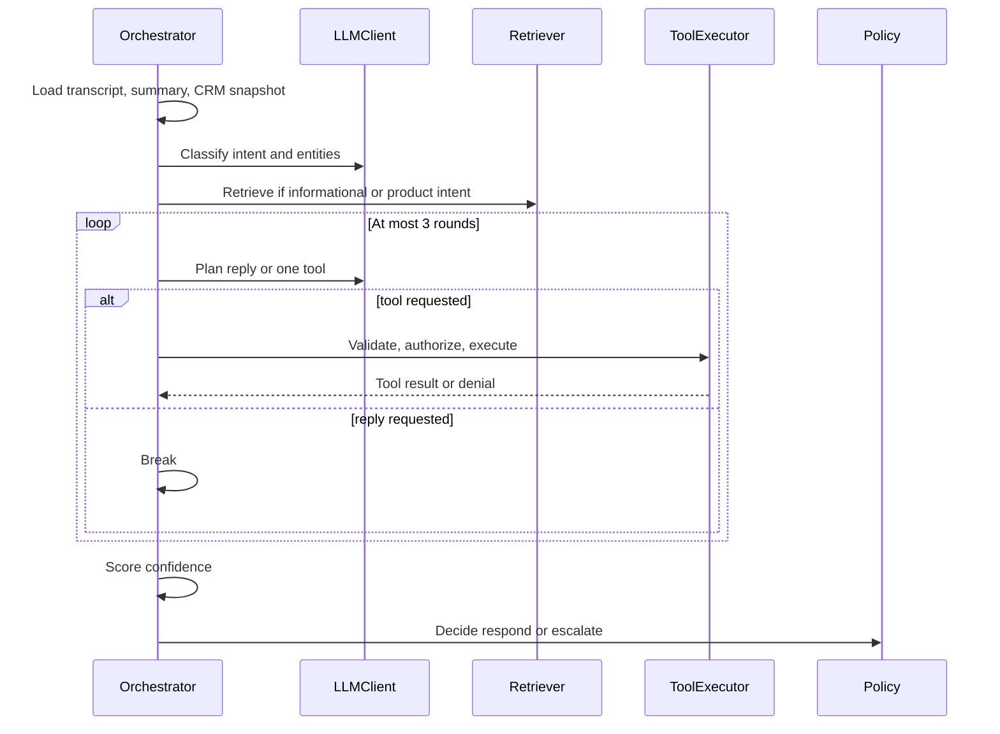

# Low-Level Design

**Status:** Proposed. No modules are implemented in the repository yet.  
**Normative stack:** Python 3.12, FastAPI, SQLAlchemy 2, Alembic, Pydantic v2, PostgreSQL 16 with pgvector. Web: React, TypeScript, Vite. Mobile: Expo.

Names in this document are the names implementers should use. If a name changes, update the API spec and the database design in the same change.

## 1. Module structure

One backend process. UI clients are separate deployable frontends. They share no code with the backend except the HTTP contract.

```text
backend/app/
  api/v1/            HTTP and WebSocket edges
  core/              config, errors, logging, dependencies
  db/models/         SQLAlchemy models
  auth/              passwords, tokens, RBAC
  services/          CRM use cases
  channels/          adapters and canonical messages
  ai/                orchestrator, policy, tools, RAG
  notifications/
  analytics/
```

Dependency direction:



`ai` must not import `db.session` to run arbitrary queries. It receives service objects. Services own transactions.

## 2. Backend package structure

| Module | Contents |
| --- | --- |
| `app/main.py` | FastAPI app, routers, WebSocket routes, startup migration check |
| `app/core/config.py` | Settings from environment. No secrets in code |
| `app/core/errors.py` | `AppError` and the standard error body |
| `app/core/logging.py` | JSON logs, redaction filter |
| `app/core/deps.py` | `get_db`, `get_current_user`, `require_permission` |
| `app/db/models/` | One file per aggregate: user, customer, lead, conversation, journey, ai, knowledge, notification, audit |
| `app/services/customer_service.py` | Profile and contact identity |
| `app/services/lead_service.py` | Lead lifecycle |
| `app/services/conversation_service.py` | Threads, messages, lock |
| `app/services/followup_service.py` | Scheduling rules |
| `app/services/task_service.py` | Tasks |
| `app/services/journey_service.py` | Append-only timeline |
| `app/services/escalation_service.py` | Queue and takeover |
| `app/services/identity_service.py` | Channel identity to customer |
| `app/ai/orchestrator.py` | Turn loop |
| `app/ai/tools/executor.py` | Authorize, validate, idempotency, call service |
| `app/channels/router.py` | Pick adapter, dedupe, start turn |

A service method that writes data also writes the audit log and, when relevant, the journey event. Callers do not do that themselves.

## 3. Frontend module structure

```text
frontend/src/
  app/router.tsx
  auth/            token storage, route guards
  api/client.ts    fetch wrapper, error parsing
  pages/           one folder per screen in FRONTEND-ARCHITECTURE.md
  components/      layout, tables, conversation thread, timeline
  widget/          public chat entry, built as a second Vite entry
```

Server state uses TanStack Query. Auth state uses React context. There is no global client store of CRM records.

## 4. AI module structure

| File | Role |
| --- | --- |
| `ai/orchestrator.py` | `handle_inbound(message_id) -> TurnResult` |
| `ai/intent.py` | Structured intent call |
| `ai/planner.py` | Tool-or-reply call |
| `ai/confidence.py` | Combine model score and rules |
| `ai/escalation_policy.py` | Deterministic escalate / respond |
| `ai/prompts.py` | Versioned prompt templates |
| `ai/llm/base.py` | `LLMClient` protocol |
| `ai/llm/openai_compatible.py` | Default HTTP adapter |
| `ai/tools/registry.py` | Name, schema, permission, handler |
| `ai/tools/executor.py` | The only execution path |
| `ai/rag/ingest.py` | Publish pipeline |
| `ai/rag/retrieve.py` | Top-k chunks |

`TurnResult` fields: `decision` (`respond`, `escalate`, `failed`), `outbound_message_id`, `escalation_id`, `action_ids`.

## 5. Integration module structure

| File | Role |
| --- | --- |
| `channels/base.py` | `ChannelAdapter` protocol |
| `channels/canonical.py` | `CanonicalMessage` |
| `channels/website.py` | WebSocket and REST widget |
| `channels/email.py` | Inbound webhook and SMTP send |
| `channels/whatsapp.py` | Interface plus simulator payload mapping |
| `channels/facebook.py` | Same |
| `channels/instagram.py` | Same |
| `channels/voice.py` | Transcript in, text out |
| `channels/simulator.py` | Dev-only HTTP entry |

Adapters return `CanonicalMessage` or raise `WebhookRejected`. They do not call `LeadService`.

## 6. Authentication module

**Responsibility.** Prove staff identity and attach permissions. Separately, authenticate the public widget and inbound webhooks.

**Inputs.** Login email and password. Refresh token. Widget key. Webhook signature.

**Outputs.** Access JWT, refresh token, current user on the request, 401/403 errors.

**Dependencies.** `users`, `refresh_tokens`, `roles`, `role_permissions`, password hasher, JWT library.

**Main services.**

- `AuthService.login(email, password) -> TokenPair`
- `AuthService.refresh(refresh_token) -> TokenPair`
- `AuthService.logout(refresh_token) -> None`
- `RBAC.require(user, permission_code)`

**Important functions.** `hash_password`, `verify_password`, `issue_access_token`, `hash_refresh_token`.

**Error handling.** Unknown email and wrong password return the same `AUTH_INVALID` message. Expired access token returns `AUTH_EXPIRED`. Reuse of a rotated refresh token revokes the whole family and returns `AUTH_REVOKED`.

**Security.** Access token claims: `sub` (user id), `role`, `exp`, `type=access`. Permissions are loaded from the database on each request so a role change applies without waiting for token expiry. Refresh tokens are random 256-bit values, stored as SHA-256 hashes.

Public chat does not issue a staff JWT. It issues a random `visitor_session_id` stored in `customer_contacts` for channel `website`.

## 7. Customer management

**Responsibility.** Create and maintain the person record and their channel identities.

**Inputs.** Staff writes from the API. Inbound channel identity from `IdentityService`. Limited writes from the `update_customer` tool.

**Outputs.** `Customer` DTO. Journey event `inquiry` or profile update. Audit row.

**Dependencies.** `customers`, `customer_contacts`, audit, journey.

**Main service.** `CustomerService`

**Important functions.**

- `get(customer_id)`
- `search(query, limit)`
- `create(payload, actor)`
- `update(customer_id, payload, actor)` — staff path, still field-validated
- `apply_agent_update(customer_id, patch, actor)` — allow-list only
- `attach_contact(customer_id, channel, external_identity, verified)`

**Allow-list for the AI patch.** `full_name` only when status is `provisional`. `primary_email`, `primary_phone`, `preferred_channel`. `notes` are appended with a timestamp prefix, never replaced. Tags may be added from a fixed vocabulary: `pricing`, `support`, `complaint`, `sales`.

**Error handling.** Duplicate `(channel, external_identity)` returns `CONTACT_CONFLICT` and does not overwrite the other customer. Invalid email or phone returns `VALIDATION_ERROR`.

**Security.** Agents may read customers. They may update fields they are permitted to edit. The AI cannot set `status` to `inactive`, change `owner_user_id`, or delete.

## 8. Lead management

**Responsibility.** Track a sales interest from first request to a staff-owned outcome.

**Inputs.** Staff API or `create_lead` / `update_lead`.

**Outputs.** Lead DTO. Journey events `lead_created` and, when status changes, the matching stage event.

**Dependencies.** Customer must exist. Optional conversation id.

**Main service.** `LeadService`

**Statuses.** `new`, `contacted`, `qualified`, `unqualified`, `converted`, `lost`.

**Transitions the AI may perform.**

| From | To | Condition |
| --- | --- | --- |
| — | `new` | Create, when intent is sales and a customer id exists |
| `new` | `contacted` | A conversation message has been exchanged |
| `new` or `contacted` | `qualified` | Reachable email or phone exists, and the customer named a product or package |

**Transitions reserved for staff.** `converted`, `lost`, and any move to `unqualified`. The AI tool returns `TOOL_DENIED` for those statuses.

**Important functions.** `create`, `update_status`, `update_interest`, `list_by_customer`, `list_queue`.

**Error handling.** A second open lead for the same customer and the same `interest_summary` product key updates the existing lead instead of inserting another. The idempotency key on the AI action also blocks double-create.

**Security.** Delete is `lead.delete`, supervisor and admin only. The AI has no delete tool.

## 9. Conversation management

**Responsibility.** Store threads and messages, enforce the human lock, and feed context to the agent.

**Inputs.** Normalized inbound messages. Staff replies. AI outbound messages.

**Outputs.** Conversation and message rows. WebSocket events to the assigned agent and the widget.

**Dependencies.** Customer, channel, escalation service when status becomes `pending_human`.

**Main service.** `ConversationService`

**Important functions.**

- `get_or_open(customer_id, channel)` — one open conversation per customer per channel
- `append_message(conversation_id, canonical)` — dedupe on external id
- `history(conversation_id, limit=30)`
- `lock_for_staff(conversation_id, user_id)` — sets `ai_enabled=false`
- `release_to_ai(conversation_id, user_id)` — supervisor or the locking user
- `staff_reply(conversation_id, user_id, text)`

**Error handling.** Messages appended while locked by someone else return `CONVERSATION_LOCKED` for the AI sender. Staff who do not hold the lock get the same error. Duplicate external ids return the original message with `duplicate=true` and do not call the orchestrator again.

**Security.** Agents see unassigned open conversations and their own assigned ones. Supervisors see all. The widget can read only messages in its visitor session.

## 10. Follow-up management

**Responsibility.** Schedule a future contact and remind the assignee.

**Inputs.** Staff API or `create_followup`. Due scanner inside the process.

**Outputs.** Follow-up row, notification when due, journey event.

**Main service.** `FollowUpService`

**Functions.** `create`, `complete`, `cancel`, `list_due`, `list_for_user`.

**Rules.**

- `scheduled_at` must be in the future and within 30 days.
- The AI may create at most one open follow-up per lead per calendar day.
- Channel must be one of the known channel codes.
- Completing a follow-up requires a staff user. The AI does not mark follow-ups complete.

**Error handling.** Rule violations return `FOLLOWUP_REJECTED` with a stable reason code. The agent must tell the customer it could not schedule, and must not claim success.

## 11. Task management

**Responsibility.** Internal work that is not a customer-visible follow-up. Example: "confirm refund with finance" after an escalation.

**Inputs.** Staff API or `create_support_task`.

**Outputs.** Task row, notification to assignee if set, otherwise to the supervisor queue.

**Main service.** `TaskService`

**Functions.** `create`, `assign`, `update_status`, `list`.

**Rules.** The AI may create tasks with priority `low`, `medium`, or `high`. It may not set priority `urgent` and may not assign a specific user. Assignment is a staff action. The AI cannot close tasks.

**Error handling.** Missing title returns `VALIDATION_ERROR`. The turn continues; the planner sees the tool error.

## 12. Escalation management

**Responsibility.** Move a conversation from the AI to a person, track SLA, and record the outcome.

**Inputs.** Policy engine, explicit customer request, staff "escalate" action, `escalate_to_human` tool.

**Outputs.** Escalation row, conversation status `pending_human`, notifications, journey event.

**Main service.** `EscalationService`

**Functions.** `open`, `assign`, `take_over`, `resolve`, `list_queue`.

**Statuses.** `open`, `assigned`, `in_progress`, `resolved`, `cancelled`.

**Priority and prototype SLA** (from creation time, lab hours, not a 24/7 contact center):

| Priority | Examples | Target first human response |
| --- | --- | --- |
| urgent | Payment dispute, abusive complaint, legal threat | 15 minutes |
| high | Customer asked for a human, repeated tool failure | 1 hour |
| medium | Low confidence on a non-sensitive request | 4 hours |
| low | Staff-created review | 1 business day |

**Takeover.** `take_over` assigns the escalation, locks the conversation, and sets `ai_enabled=false`. Further inbound messages on that conversation notify the assignee and do not call the orchestrator.

**Resolution.** Staff submits a note. Status becomes `resolved`. The note is stored on the escalation and as a journey event. It is not automatically fine-tuned into the model. The MVP "learning" step is retrieval: the note can be copied into an internal knowledge article by a supervisor if the team wants future answers grounded on it. The system does not train the model.

**Error handling.** Opening a second active escalation on the same conversation returns the existing row.

Detail: [HUMAN-ESCALATION.md](../features/HUMAN-ESCALATION.md).

## 13. Analytics

**Responsibility.** Read-only aggregates for the dashboard. No separate warehouse.

**Inputs.** Date range query parameters.

**Outputs.** Metric DTOs listed in [ANALYTICS.md](../features/ANALYTICS.md).

**Main service.** `AnalyticsService.dashboard(range, actor)`.

**Dependencies.** SQL over `leads`, `messages`, `customer_interactions`, `ai_actions`, `escalations`, `follow_ups`.

**Error handling.** A range longer than 366 days returns `VALIDATION_ERROR`. Agents receive only metrics scoped to their user id. Supervisors and admins receive organization totals.

**Security.** `analytics.read`. No write endpoints.

## 14. Notification system

**Responsibility.** Persist staff notifications and fan them out to connected WebSockets. Optionally send email for escalation and SLA warnings.

**Main service.** `NotificationService.notify(user_id, type, title, body, entity)`.

**Types.** `new_lead`, `followup_due`, `high_priority_customer`, `ai_escalation`, `conversation_assigned`, `task_assigned`, `sla_warning`.

**Error handling.** A failed email send does not roll back the in-app notification. The failure is logged with `channel=email` and the notification id.

Detail: [NOTIFICATIONS.md](../features/NOTIFICATIONS.md).

## 15. Knowledge base

**Responsibility.** Store approved business text and serve chunks to the agent.

**Main services.** `KnowledgeService` for documents. `ai/rag` for chunking, embeddings, and search.

**Functions.** `create_draft`, `update_draft`, `publish`, `archive`, `search`.

**Publish pipeline.** Split the body, embed each chunk, replace previous chunks for that document in one transaction. A failed embedding call leaves the previous published chunks in place and returns `EMBEDDING_FAILED`.

**Security.** `knowledge.write` for drafts. `knowledge.publish` to publish. The AI only has `search_knowledge`, and only over `published` chunks.

Detail: [RAG-ARCHITECTURE.md](../ai/RAG-ARCHITECTURE.md).

## 16. AI agent orchestration

**Responsibility.** Run one inbound message through understanding, retrieval, tools, policy, and a reply.

**Inputs.** `message_id` of a stored inbound customer message. The conversation must have `ai_enabled=true`.

**Outputs.** `TurnResult`, rows in `ai_actions`, optional CRM mutations, one outbound message or one escalation.

**Dependencies.** Conversation, identity, customer, lead, follow-up, task, escalation, knowledge retrieval, `LLMClient`, notification.

**Entry point.** `AgentOrchestrator.handle_inbound(message_id)`.

**Loop.**



**Important functions.** `build_snapshot`, `classify`, `plan`, `execute_tool`, `finalize`.

**Error handling.**

| Failure | Behavior |
| --- | --- |
| LLM timeout or 5xx | One retry. Then `decision=failed`, escalation reason `llm_unavailable`, customer message: the team will follow up |
| Tool denied | Result returned to the planner. The planner may answer with a refusal or call `escalate_to_human` |
| Tool exception | Logged, result `failed`. Counts toward repeated failure |
| Invalid JSON from model | One repair prompt. Then escalate with `model_output_invalid` |
| Conversation locked between load and send | Abort send. Do not write a second outbound message |

**Security.** The system prompt states that customer text is data. Tool schemas are the only actions. The executor ignores tool names that are not registered. Arguments that fail Pydantic validation never reach a service.

The snapshot passed to the model includes name, contact handles the customer already used, open lead titles and statuses, and the last five journey event types. It excludes password hashes, staff notes marked internal if the column `visibility=staff` is set, audit payloads, and other customers.

Per-tool contracts are in [AI-ARCHITECTURE.md](../ai/AI-ARCHITECTURE.md).
