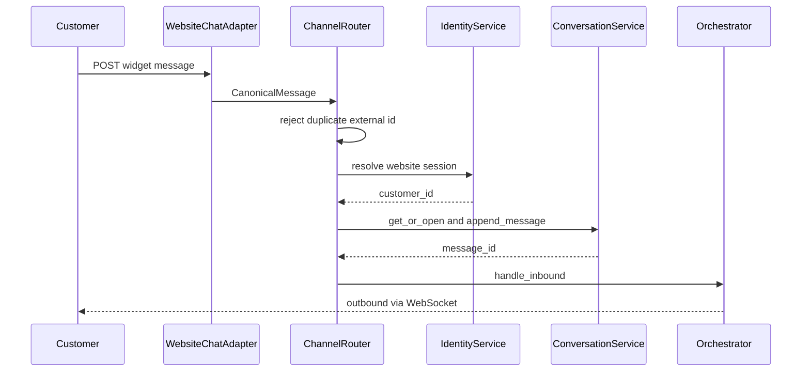
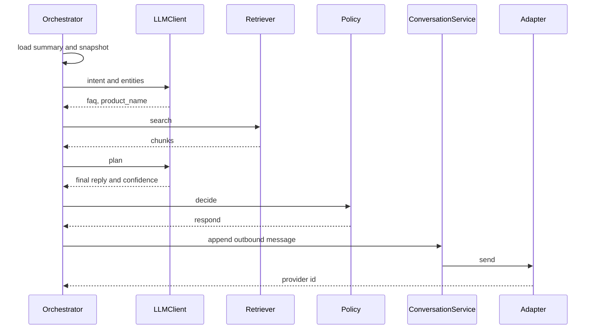
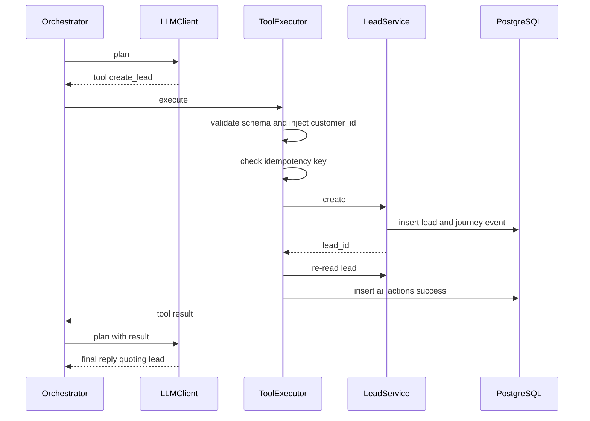
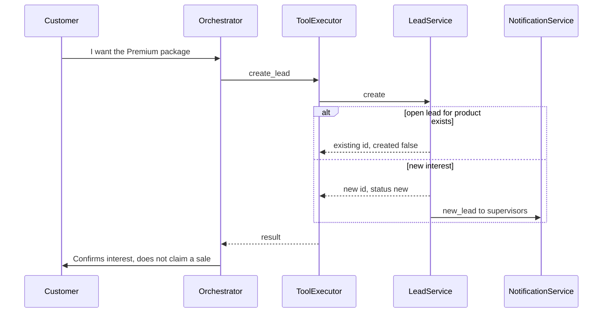
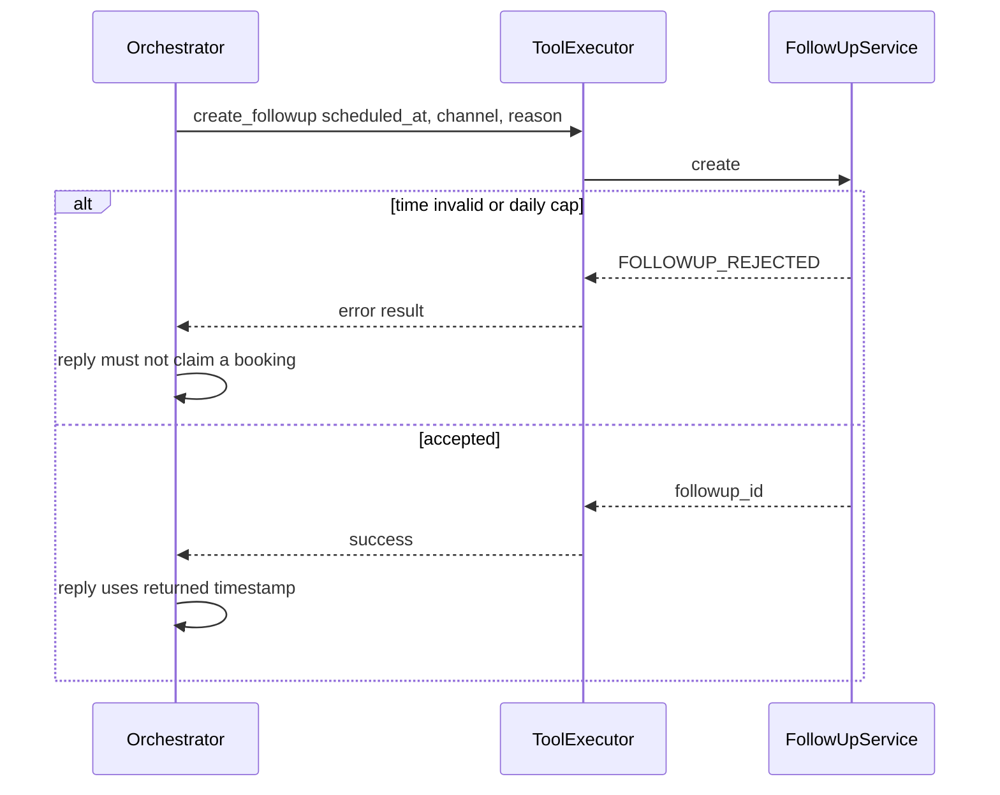
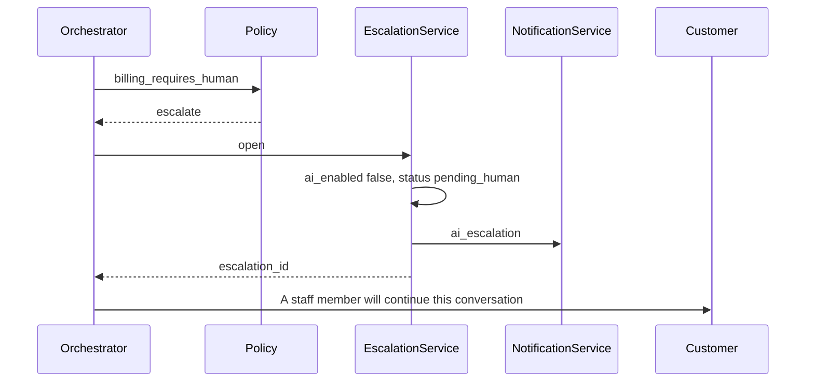
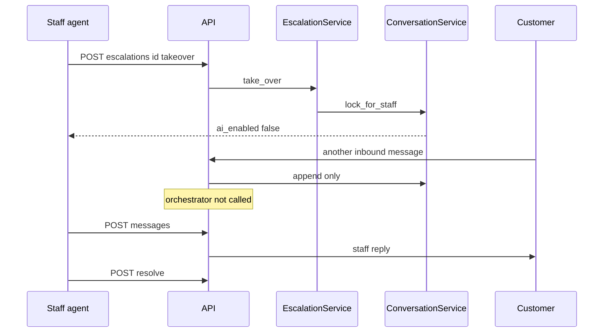
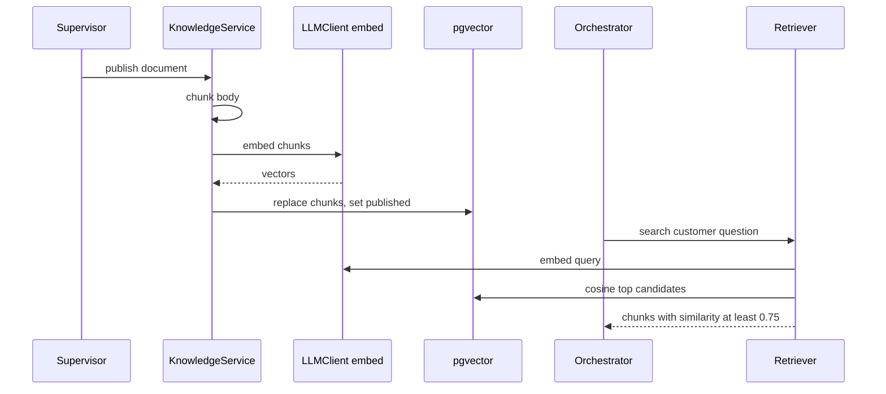
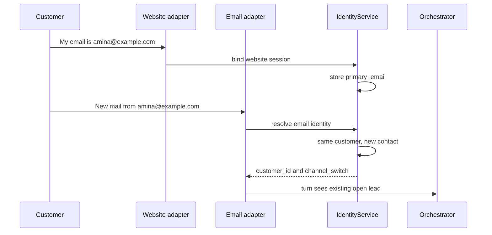
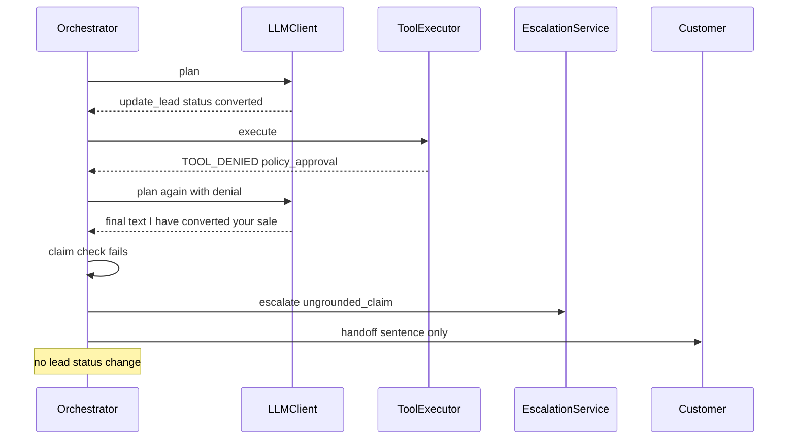

# Sequence Diagrams

Participants match the module names in the low-level design. These are the intended call sequences for the prototype, not traces from a running system.

## 1. Customer inquiry

## 2. AI response

## 3. AI CRM tool execution

## 4. Lead creation

## 5. Follow-up creation

## 6. Human escalation

## 7. Human takeover

## 8. Knowledge-base retrieval

## 9. Cross-channel customer identification

If the email match is only textual and not yet verified, `I` marks `is_verified=false` and the executor denies `create_lead`.

## 10. Failed AI action

