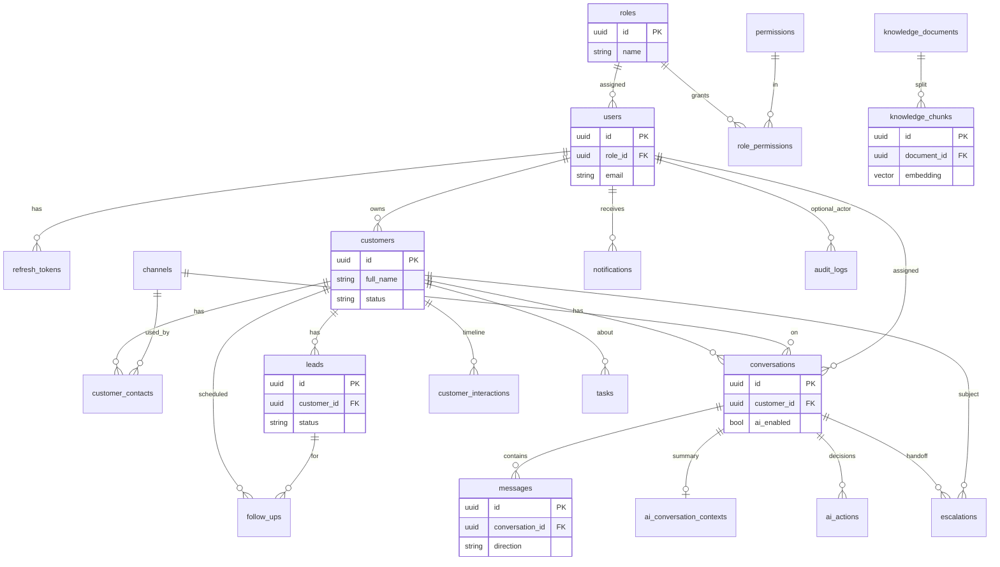

# Database Design

**Status:** Proposed schema. The repository has no migrations, models, or database.  
**Engine:** PostgreSQL 16 with the `pgvector` and `pgcrypto` extensions.  
**Keys:** UUID primary keys generated in the database with `gen_random_uuid()`.  
**Timestamps:** `timestamptz`, stored in UTC.  
**Access:** SQLAlchemy sessions in CRM services only.

## Why this database

Customer, lead, conversation, and permission data is relational. Foreign keys and unique constraints are the main defense against duplicate contacts and duplicate webhook messages. Embeddings sit in the same database so the prototype does not operate a second store. pgvector is enough for a few hundred to a few thousand chunks.

SQLite was rejected because concurrent staff sessions and vector search are a poor fit. A document database was rejected because the CRM integrity rules are relational. A hosted vector database was rejected because it adds cost and another secret for no functional gain at this size.

## Conventions

- Enum-like columns are PostgreSQL enums created in the migration, listed below as `enum`.
- Boolean columns are `not null` with a default.
- Money, if a lead value is stored, uses `numeric(12,2)`. The seed catalog prices live in knowledge documents, not in a price table. There is no payment table.
- JSON columns are `jsonb` and default to `'{}'` or `'[]'` where noted.
- `actor_type` is the enum `user | ai_agent | system`. `actor_id` is a UUID and is null when `actor_type` is `ai_agent` or `system`.

## Entity relationship diagram

The diagram shows identity relationships. Columns below are the full logical model.

---

## roles

**Purpose.** The staff roles.

**Implemented differently.** `auth-service` seeds the frontend's five roles and their permissions, and adds `organizations` and `memberships` from [ADR-010](../adr/ADR-010-multi-tenancy.md). `memberships` also holds `is_active` and `manager_id`, because a person's status and reporting line belong to each company, and `organization_channels` stores channel settings. See `services/auth-service/app/db/migrations/versions/`. The role and permission values listed below are the earlier design.

| Field | Type | Constraints |
| --- | --- | --- |
| id | uuid | PK |
| name | varchar(32) | unique, not null. Values seeded: `admin`, `supervisor`, `agent` |
| description | varchar(200) | not null |

Indexes: unique on `name`.

## permissions

**Purpose.** Stable permission codes checked by the API.

| Field | Type | Constraints |
| --- | --- | --- |
| id | uuid | PK |
| code | varchar(64) | unique, not null. Example `customer.read` |
| description | varchar(200) | not null |

Seed codes: `customer.read`, `customer.write`, `lead.read`, `lead.write`, `lead.delete`, `conversation.read`, `conversation.reply`, `conversation.takeover`, `followup.read`, `followup.write`, `task.read`, `task.write`, `escalation.read`, `escalation.assign`, `knowledge.read`, `knowledge.write`, `knowledge.publish`, `analytics.read`, `user.manage`, `audit.read`, `notification.read`.

## role_permissions

**Purpose.** Many-to-many grant.

| Field | Type | Constraints |
| --- | --- | --- |
| role_id | uuid | PK, FK roles.id on delete cascade |
| permission_id | uuid | PK, FK permissions.id on delete cascade |

Seed matrix matches [SECURITY-DESIGN.md](../security/SECURITY-DESIGN.md).

## users

**Purpose.** Staff who can log in. The AI is not a user row.

| Field | Type | Constraints |
| --- | --- | --- |
| id | uuid | PK |
| role_id | uuid | FK roles.id, not null |
| email | varchar(254) | unique, not null |
| password_hash | varchar(255) | not null |
| full_name | varchar(120) | not null |
| is_active | boolean | not null default true |
| created_at | timestamptz | not null |
| updated_at | timestamptz | not null |

Indexes: unique `email`.

## refresh_tokens

**Purpose.** Rotating refresh sessions.

| Field | Type | Constraints |
| --- | --- | --- |
| id | uuid | PK |
| user_id | uuid | FK users.id, not null |
| token_hash | char(64) | unique, not null |
| family_id | uuid | not null |
| expires_at | timestamptz | not null |
| revoked_at | timestamptz | null |
| created_at | timestamptz | not null |

Indexes: `user_id`, unique `token_hash`.

## channels

**Purpose.** Lookup of channel codes so messages cannot store a typo.

| Field | Type | Constraints |
| --- | --- | --- |
| id | uuid | PK |
| code | varchar(32) | unique. `whatsapp`, `facebook`, `instagram`, `website`, `email`, `voice` |
| display_name | varchar(64) | not null |
| is_enabled | boolean | not null default false |

Seed: `website` enabled. `email` enabled when the email phase is turned on. Others present with `is_enabled=false` until a real transport is configured. The simulator may post into a disabled channel only when `ENABLE_CHANNEL_SIMULATOR=true`, and the stored message metadata includes `"simulated": true`.

## customers

**Purpose.** The unified profile.

| Field | Type | Constraints |
| --- | --- | --- |
| id | uuid | PK |
| full_name | varchar(160) | not null. Provisional default `Website visitor` |
| primary_email | varchar(254) | null |
| primary_phone | varchar(32) | null |
| status | enum | `provisional`, `active`, `inactive`. not null |
| company_name | varchar(160) | null |
| preferred_channel | varchar(32) | null, FK not required; checked against channel codes in the service |
| notes | text | not null default `''` |
| owner_user_id | uuid | FK users.id, null |
| created_at | timestamptz | not null |
| updated_at | timestamptz | not null |

Indexes: `primary_email`, `primary_phone`, `owner_user_id`, `status`.

Check: `status = 'provisional' OR full_name <> ''`.

## customer_contacts

**Purpose.** One external identity on one channel, pointing at one customer.

| Field | Type | Constraints |
| --- | --- | --- |
| id | uuid | PK |
| customer_id | uuid | FK customers.id, not null |
| channel_id | uuid | FK channels.id, not null |
| external_identity | varchar(320) | not null |
| is_verified | boolean | not null default false |
| created_at | timestamptz | not null |

Unique `(channel_id, external_identity)`. Index on `customer_id`.

This unique constraint is the identity-resolution guard.

## leads

**Purpose.** A sales interest.

| Field | Type | Constraints |
| --- | --- | --- |
| id | uuid | PK |
| customer_id | uuid | FK customers.id, not null |
| conversation_id | uuid | FK conversations.id, null |
| title | varchar(120) | not null |
| product_name | varchar(120) | null |
| source_channel_id | uuid | FK channels.id, not null |
| status | enum | `new`, `contacted`, `qualified`, `unqualified`, `converted`, `lost` |
| interest_summary | varchar(1000) | not null |
| estimated_value | numeric(12,2) | null. Staff-only write. AI schema has no such field |
| assigned_user_id | uuid | FK users.id, null |
| created_actor_type | enum actor_type | not null |
| created_actor_id | uuid | null |
| created_at | timestamptz | not null |
| updated_at | timestamptz | not null |

Indexes: `customer_id`, `status`, `assigned_user_id`, `(customer_id, status)`.

Partial unique index: one row per `(customer_id, product_name)` where `status in ('new','contacted','qualified')` and `product_name is not null`. This is how `create_lead` avoids duplicates.

## conversations

**Purpose.** A thread on one channel.

| Field | Type | Constraints |
| --- | --- | --- |
| id | uuid | PK |
| customer_id | uuid | FK customers.id, not null |
| channel_id | uuid | FK channels.id, not null |
| status | enum | `open`, `pending_human`, `assigned`, `resolved`, `closed` |
| assigned_user_id | uuid | FK users.id, null |
| ai_enabled | boolean | not null default true |
| locked_by_user_id | uuid | FK users.id, null |
| subject | varchar(200) | null |
| last_message_at | timestamptz | null |
| created_at | timestamptz | not null |
| updated_at | timestamptz | not null |

Indexes: `(status, last_message_at desc)`, `customer_id`, `assigned_user_id`.

Check: `ai_enabled = false OR locked_by_user_id is null`. A lock always disables the AI.

Partial unique index: one conversation per `(customer_id, channel_id)` where status in (`open`, `pending_human`, `assigned`).

## messages

**Purpose.** Every inbound and outbound item.

| Field | Type | Constraints |
| --- | --- | --- |
| id | uuid | PK |
| conversation_id | uuid | FK conversations.id, not null |
| direction | enum | `inbound`, `outbound` |
| sender_type | enum | `customer`, `ai_agent`, `staff`, `system` |
| sender_user_id | uuid | FK users.id, null |
| external_message_id | varchar(128) | null |
| message_type | enum | `text`, `image`, `audio`, `system`. MVP uses `text` and `system` |
| content | text | not null |
| metadata | jsonb | not null default `{}` |
| created_at | timestamptz | not null |

Unique `(conversation_id, external_message_id)` where `external_message_id is not null`. The router also checks a second unique index on `(channel via conversation, external_message_id)` by storing `channel_id` denormalized:

Add column `channel_id uuid not null` FK, unique `(channel_id, external_message_id)` where external id is not null. This stops the same provider event creating two conversations.

Index: `(conversation_id, created_at)`.

Check: `sender_type <> 'staff' OR sender_user_id is not null`.

## customer_interactions

**Purpose.** Append-only journey timeline.

| Field | Type | Constraints |
| --- | --- | --- |
| id | uuid | PK |
| customer_id | uuid | FK customers.id, not null |
| conversation_id | uuid | null FK |
| lead_id | uuid | null FK |
| follow_up_id | uuid | null FK |
| escalation_id | uuid | null FK |
| event_type | enum | `first_contact`, `inquiry`, `lead_created`, `qualification`, `follow_up_scheduled`, `follow_up_completed`, `conversion`, `purchase`, `support`, `complaint`, `escalation`, `resolution`, `channel_switch`, `profile_updated` |
| channel_id | uuid | null FK |
| summary | varchar(500) | not null |
| visibility | enum | `customer_safe`, `staff`. default `customer_safe` |
| actor_type | enum | not null |
| actor_id | uuid | null |
| occurred_at | timestamptz | not null |
| metadata | jsonb | not null default `{}` |

Indexes: `(customer_id, occurred_at desc)`.

`purchase` is written only by staff when they set a lead to `converted`. The AI cannot emit it. There is no order table in the prototype; the event records that staff confirmed a win.

## follow_ups

**Purpose.** A promised future contact.

| Field | Type | Constraints |
| --- | --- | --- |
| id | uuid | PK |
| customer_id | uuid | FK, not null |
| lead_id | uuid | FK, null |
| conversation_id | uuid | FK, null |
| assigned_user_id | uuid | FK, null |
| scheduled_at | timestamptz | not null |
| channel_id | uuid | FK, not null |
| reason | varchar(500) | not null |
| status | enum | `scheduled`, `completed`, `cancelled`, `missed` |
| created_actor_type | enum | not null |
| created_actor_id | uuid | null |
| completed_at | timestamptz | null |
| notes | varchar(1000) | not null default `''` |
| created_at | timestamptz | not null |

Indexes: `(status, scheduled_at)`, `assigned_user_id`, `customer_id`.

## tasks

**Purpose.** Internal work items.

| Field | Type | Constraints |
| --- | --- | --- |
| id | uuid | PK |
| title | varchar(140) | not null |
| description | varchar(2000) | not null default `''` |
| customer_id | uuid | null FK |
| conversation_id | uuid | null FK |
| lead_id | uuid | null FK |
| escalation_id | uuid | null FK |
| assigned_user_id | uuid | null FK |
| priority | enum | `low`, `medium`, `high`, `urgent` |
| status | enum | `open`, `in_progress`, `done`, `cancelled` |
| due_at | timestamptz | null |
| created_actor_type | enum | not null |
| created_actor_id | uuid | null |
| created_at | timestamptz | not null |
| updated_at | timestamptz | not null |

Indexes: `(status, priority)`, `assigned_user_id`, `customer_id`.

## ai_actions

**Purpose.** One row per model decision or tool attempt. This is the AI audit.

| Field | Type | Constraints |
| --- | --- | --- |
| id | uuid | PK |
| conversation_id | uuid | FK, not null |
| message_id | uuid | FK messages.id, not null. The inbound message |
| customer_id | uuid | FK, null |
| intent | varchar(40) | not null |
| entities | jsonb | not null default `{}` |
| tool_name | varchar(64) | null for the final decision row |
| tool_input | jsonb | not null default `{}`. Redact tokens if any appear |
| tool_output | jsonb | not null default `{}` |
| tool_status | enum | `success`, `denied`, `failed`, `skipped`, `not_applicable` |
| tool_error | varchar(200) | null |
| idempotency_key | char(64) | null |
| confidence_raw | numeric(4,3) | null |
| confidence_final | numeric(4,3) | null |
| decision | enum | `respond`, `tool`, `escalate`, `failed` |
| escalation_reason | varchar(64) | null |
| retrieved_chunk_ids | uuid[] | not null default `'{}'` |
| model_name | varchar(80) | not null |
| latency_ms | integer | not null |
| created_at | timestamptz | not null |

Indexes: `conversation_id`, `customer_id`, `created_at`, unique `idempotency_key` where not null.

Do not copy the full prompt into this table.

## ai_conversation_contexts

**Purpose.** Rolling memory so prompts stay short.

| Field | Type | Constraints |
| --- | --- | --- |
| id | uuid | PK |
| conversation_id | uuid | unique FK, not null |
| summary | varchar(2000) | not null default `''` |
| last_intent | varchar(40) | null |
| rolling_facts | jsonb | not null default `{}` |
| turn_count | integer | not null default 0 |
| updated_at | timestamptz | not null |

## escalations

**Purpose.** Human handoff record.

| Field | Type | Constraints |
| --- | --- | --- |
| id | uuid | PK |
| conversation_id | uuid | FK, not null |
| customer_id | uuid | FK, not null |
| reason_code | varchar(64) | not null |
| reason_detail | varchar(1000) | not null |
| priority | enum | `low`, `medium`, `high`, `urgent` |
| status | enum | `open`, `assigned`, `in_progress`, `resolved`, `cancelled` |
| triggered_by | enum | `ai_agent`, `customer`, `staff`, `policy` |
| assigned_user_id | uuid | null FK |
| sla_due_at | timestamptz | not null |
| resolution_notes | varchar(2000) | null |
| resolved_at | timestamptz | null |
| created_at | timestamptz | not null |

Indexes: `(status, priority, created_at)`, `assigned_user_id`, `conversation_id`.

Partial unique index: one row per `conversation_id` where status in (`open`, `assigned`, `in_progress`).

## knowledge_documents

**Purpose.** Source articles.

| Field | Type | Constraints |
| --- | --- | --- |
| id | uuid | PK |
| title | varchar(200) | not null |
| source_type | enum | `faq`, `policy`, `product`, `pricing`, `company`, `support` |
| status | enum | `draft`, `published`, `archived` |
| body | text | not null |
| version | integer | not null default 1 |
| created_by | uuid | FK users.id, not null |
| created_at | timestamptz | not null |
| updated_at | timestamptz | not null |

Index: `(status, source_type)`.

## knowledge_chunks

**Purpose.** Embeddable slices of published documents.

| Field | Type | Constraints |
| --- | --- | --- |
| id | uuid | PK |
| document_id | uuid | FK knowledge_documents.id on delete cascade |
| chunk_index | integer | not null |
| content | text | not null |
| embedding | vector(768) | not null |
| token_count | integer | not null |
| metadata | jsonb | not null default `{}` |

Unique `(document_id, chunk_index)`. HNSW index on `embedding` with `vector_cosine_ops`.

## notifications

**Purpose.** In-app staff notifications.

| Field | Type | Constraints |
| --- | --- | --- |
| id | uuid | PK |
| user_id | uuid | FK users.id, not null |
| type | varchar(40) | not null |
| title | varchar(140) | not null |
| body | varchar(500) | not null |
| entity_type | varchar(40) | not null |
| entity_id | uuid | not null |
| is_read | boolean | not null default false |
| created_at | timestamptz | not null |

Index: `(user_id, is_read, created_at desc)`.

## audit_logs

**Purpose.** Security and staff-action trail. AI tool traces live in `ai_actions`. Both exist: audit is for auth and staff mutations; `ai_actions` is for model decisions.

| Field | Type | Constraints |
| --- | --- | --- |
| id | uuid | PK |
| actor_type | enum | not null |
| actor_id | uuid | null |
| action | varchar(64) | not null. Examples `user.login`, `customer.update`, `knowledge.publish` |
| entity_type | varchar(40) | not null |
| entity_id | uuid | null |
| metadata | jsonb | not null default `{}`. No password hashes, no tokens, no full message bodies |
| ip | inet | null |
| created_at | timestamptz | not null |

Index: `(entity_type, entity_id)`, `created_at`.

## Modifications if a schema appears later

There is nothing to alter today. If a later prototype adds tables, extend this model rather than introducing a second customer collection. In particular, do not store channel payloads only inside message JSON without the unique external-id constraint. That constraint is what makes webhook retries safe.
