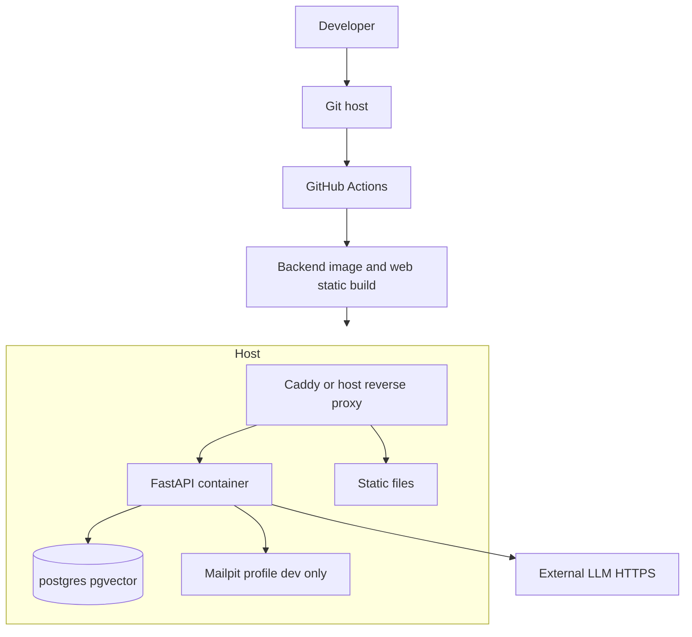

# Deployment Architecture

**Status:** Proposed. Nothing is deployed. The repository is not yet a git project.  
**Shape:** one host, Docker Compose, no Kubernetes.



Kubernetes is not justified. The prototype is one process, one database, and a handful of users.

## Environments

| | Development | Testing | Production-like demo |
| --- | --- | --- | --- |
| Where | Laptop Compose | CI services or Compose | One small VM or a university host |
| Database | PostgreSQL container | Ephemeral PostgreSQL | PostgreSQL container with a volume |
| Simulator | `ENABLE_CHANNEL_SIMULATOR=true` | true in test | **false** |
| LLM | real key or fake in unit tests | fake client | real key |
| SMTP | Mailpit | unset | optional real SMTP |
| TLS | no | no | yes, via Caddy and a hostname |
| Seed | fictional Northline data | factories | fictional data only |

"Production-like" means the demo configuration, not a public multi-tenant service.

## Processes

- `api`: Uvicorn, one worker is enough. The follow-up scanner starts in this process.
- `web`: built assets served by Caddy or by `vite preview` only in development.
- `db`: official `pgvector/pgvector` image, PostgreSQL 16.
- `mailpit`: development profile only.

Do not run two API replicas. The scanner would send duplicate notifications.

## Environment variables

| Name | Purpose |
| --- | --- |
| `DATABASE_URL` | SQLAlchemy URL |
| `JWT_SECRET` | HMAC secret, 32 bytes or more |
| `WIDGET_KEY` | Public widget header |
| `LLM_BASE_URL` | OpenAI-compatible base URL |
| `LLM_API_KEY` | Provider secret |
| `LLM_CHAT_MODEL` | Chat model id |
| `LLM_EMBED_MODEL` | Embedding model id |
| `EMBEDDING_DIM` | Must be 768 |
| `SMTP_HOST` `SMTP_PORT` `SMTP_USER` `SMTP_PASSWORD` `SMTP_FROM` | Optional email send |
| `EMAIL_WEBHOOK_SECRET` | Inbound HMAC |
| `ENABLE_CHANNEL_SIMULATOR` | true or false |
| `SIMULATOR_TOKEN` | Required if simulator is enabled |
| `WHATSAPP_TOKEN` `WHATSAPP_PHONE_ID` | Empty until connected |
| `FACEBOOK_PAGE_TOKEN` `INSTAGRAM_TOKEN` `META_APP_SECRET` | Empty until connected |
| `VOICE_PROVIDER_URL` | Empty until connected |
| `HIGH_VALUE_LEAD` | Default 5000 |
| `LOG_AI_DEBUG` | Default false |
| `CORS_ORIGINS` | Staff and widget origins |

`.env.example` should list these with blank secrets when the backend is created. Do not commit `.env`.

## Secrets

Developers keep `.env` local. The demo host sets variables in the process environment or a file outside the git tree. CI stores `LLM_API_KEY` only if live evals run there; the default CI job does not need it. Rotate a key if it appears in a log or a commit.

## CI/CD

GitHub Actions workflow, on pull request and main:

1. Install backend dependencies.
2. Run Alembic migrations against a service container.
3. Run pytest except tests marked `live_llm`.
4. Build the web app.
5. On main, optionally build a container image.

Continuous delivery to the demo host can be a manual `docker compose pull && docker compose up -d` by a teammate. Automatic deploy is optional. A broken auto-deploy during the last week is worse than a documented manual step.

## Migrations and backups

- Alembic is the only schema change path.
- Demo host: `pg_dump` daily to a file outside the container, keep 7 copies. A cron line is enough.
- Restore has been tried once before the final demo. An untested backup is not a backup.
- Lab machines may instead rebuild from migrations and seed. Say which one the team actually uses.

## Monitoring

- `GET /health` for a manual check.
- Docker restart policy `unless-stopped` on api and db.
- Logs via `docker compose logs`. The observability document defines the fields.
- No PagerDuty and no uptime vendor required. A teammate is the on-call during the demo slot.

## Build outline

```text
docker-compose.yml
  services: db, api, mailpit (profile dev)
Dockerfile
  python:3.12-slim, install requirements, run uvicorn
```

The web image can be a second stage that copies `frontend/dist`. For a class demo, copying the dist folder to Caddy is also fine.

## External dependencies at runtime

| Dependency | Required for MVP demo |
| --- | --- |
| PostgreSQL with pgvector | yes |
| LLM chat and embeddings | yes for AI scenarios, no for CRM-only screens |
| SMTP | no |
| Meta, WhatsApp, voice | no |

If the LLM key is revoked on demo day, the fallback script is: show the CRM, the stored transcript from a rehearsal, and the `ai_actions` rows. Do not invent a local model requirement in the last week unless a machine has already been measured against the latency NFRs.
