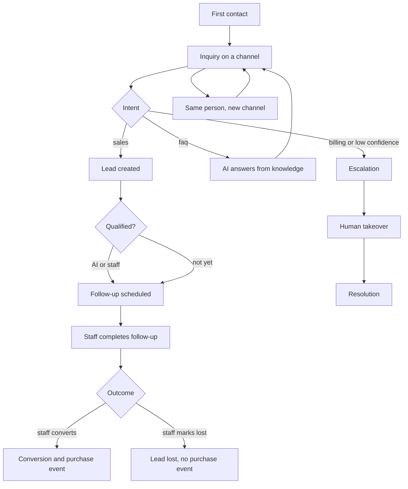
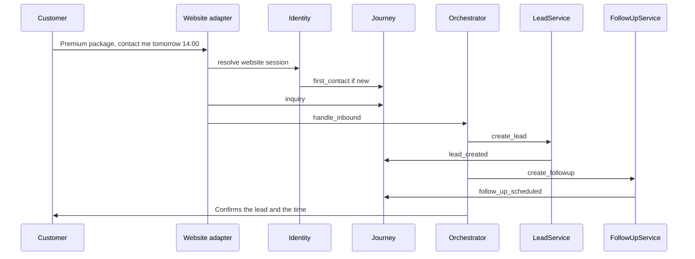

# Customer Journey

**Status:** Proposed behavior. Timeline storage is `customer_interactions`.  
**Reader:** staff customer profile. The AI sees only the last five `customer_safe` events in its snapshot.

## 1. Stages

The journey is an append-only log, not a single status field. A customer can have a sales lead and a later complaint. Forcing one linear state would hide that.

| Stage | event_type | Who writes it | When |
| --- | --- | --- | --- |
| First contact | `first_contact` | `IdentityService` | The customer row is created |
| Inquiry | `inquiry` | `ConversationService` | Each new conversation's first inbound message |
| Lead creation | `lead_created` | `LeadService.create` | AI tool or staff |
| Qualification | `qualification` | `LeadService` status change to `qualified` | AI, if the rule allows, or staff |
| Follow-up | `follow_up_scheduled` | `FollowUpService.create` | AI tool or staff |
| Follow-up done | `follow_up_completed` | `FollowUpService.complete` | Staff only |
| Conversion | `conversion` | `LeadService` status `converted` | Staff only |
| Purchase | `purchase` | Same staff action as conversion | Staff confirms the win. No payment gateway |
| Support | `support` | Task or a conversation tagged support | Staff, or AI when it creates a support task |
| Complaint | `complaint` | Orchestrator when intent is `complaint` | AI turn |
| Escalation | `escalation` | `EscalationService.open` | Policy, AI tool, customer request, or staff |
| Resolution | `resolution` | `EscalationService.resolve` or conversation status `resolved` | Staff |
| Channel change | `channel_switch` | `IdentityService` | A new channel contact attaches to an existing customer |
| Profile | `profile_updated` | `CustomerService` | Staff or AI allow-list update |

`purchase` and `conversion` are both written on the staff convert action so the timeline can show the business outcome in the words the proposal uses. They share one timestamp and the same lead id. This is not a second system of record.

## 2. Flow

## 3. Timeline presented to staff

`GET /api/v1/customers/{id}/timeline` returns events newest last in the UI (the API may return newest first; the UI sorts ascending).

Each item shows:

- Time
- Event label
- Channel icon from `channel_id`
- Actor: staff name, "AI agent", or "System"
- One-line summary, for example `Lead created: Premium package`
- Link to the lead, conversation, follow-up, or escalation when that id is present

The profile header shows current status, open lead count, and next scheduled follow-up. Those are queries, not extra journey events.

## 4. Sequence: interest through follow-up

## 5. Rules

- Events are never updated. A correction is a new event.
- Summaries are written by services from templates, not by the model, so the timeline cannot be prompt-injected.
- `visibility=staff` is for internal resolution notes that include operational detail. The default is `customer_safe`.
- Deleting a lead that is still `new` does not delete timeline rows. The lead id may dangle only in that narrow delete path; the UI shows "lead removed" if the join misses. Normal operation uses status `lost` instead of delete.

## 6. Demo trace

For the premium-package scenario the timeline after the turn should read:

1. First contact, website, system
2. Inquiry, website, system
3. Lead created, AI agent, Premium package
4. Follow-up scheduled, AI agent, tomorrow 14:00 website or phone

If the customer then demands a refund:

5. Complaint or escalation, AI agent
6. Resolution, staff, after the human finishes

That sequence is the acceptance check for journey tracking in the MVP.
