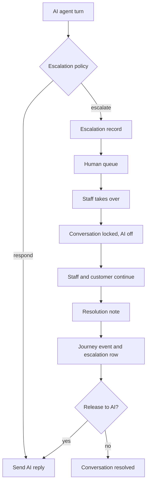

# Human Escalation

**Status:** Proposed.  
**Purpose:** Stop the AI when the decision policy says a person must own the case, and give that person a queue, a lock, and an audit trail.

## 1. Path

The model does not assign a person and does not close the escalation.

## 2. Triggers

From [AI-ARCHITECTURE.md](../ai/AI-ARCHITECTURE.md), codes:

- `low_confidence`
- `human_requested`
- `sensitive_complaint`
- `billing_requires_human`
- `tool_not_permitted`
- `repeated_failure`
- `identity_conflict`
- `policy_approval`
- `llm_unavailable`
- `model_output_invalid`
- `ungrounded_claim`
- `data_store_unavailable`
- `staff_requested` for the staff HTTP action

Customer request is both a classifier intent and a policy rule, so a missed label is not the only control. The policy also escalates when the inbound text matches a small explicit list: "talk to a human", "real person", "agent please", case-insensitive. The list is code, reviewed in git, not a model guess. It is intentionally short so ordinary sentences do not escalate.

## 3. Priority

| Priority | SLA target for first staff reply | Default notify |
| --- | --- | --- |
| urgent | 15 minutes | All supervisors |
| high | 1 hour | All supervisors |
| medium | 4 hours | Queue, in-app |
| low | 1 business day | Queue, in-app |

SLA clocks use UTC timestamps. The prototype does not model public holidays. `sla_due_at` is set from the table at creation. A background pass every minute marks overdue escalations by creating an `sla_warning` notification if one has not been sent.

## 4. Assignment

- `POST /escalations/{id}/assign` with `escalation.assign` sets `assigned_user_id` and status `assigned`.
- Agents may take an unassigned item themselves through takeover.
- The AI cannot set `assigned_user_id`.

## 5. Status

`open` → `assigned` → `in_progress` → `resolved`

`cancelled` is for duplicates opened by mistake by staff. Cancelling re-enables the AI only if the cancelling user also releases the conversation.

Active means `open`, `assigned`, or `in_progress`. At most one active row per conversation.

## 6. Agent takeover and conversation locking

`takeover`:

1. Sets escalation `in_progress` and `assigned_user_id` to the caller.
2. Sets conversation `locked_by_user_id`, `assigned_user_id`, `ai_enabled=false`, status `assigned`.
3. Writes audit `escalation.takeover`.
4. Pushes `conversation.locked` on the staff socket.

While locked:

- Inbound customer messages are stored and forwarded to the lock holder.
- `AgentOrchestrator.handle_inbound` returns immediately.
- Other staff replies receive 409 `CONVERSATION_LOCKED`.
- Supervisors with `escalation.assign` may takeover to transfer the lock. The previous lock is replaced. Audit records both user ids.

## 7. Resolution

`resolve` requires notes. It sets `resolved`, `resolved_at`, and writes journey `resolution` with `visibility=staff` if the notes contain operational detail. The MVP stores all resolution notes as `staff` visibility so they are not copied into the model prompt by accident.

The AI does not train on the note. A supervisor who wants the organization to answer similar questions later creates or edits a knowledge document. That human edit is the learning step. It is deliberate and reviewed.

## 8. Audit trail

| Event | Where |
| --- | --- |
| Why the AI escalated | `ai_actions.decision=escalate`, `escalation_reason`, confidence |
| Queue changes | `audit_logs` action `escalation.assign`, `escalation.takeover`, `escalation.resolve` |
| Customer-visible handoff | outbound system message and journey `escalation` |
| Outcome | `escalations.resolution_notes` |

## 9. Customer experience

On escalate, the customer gets one message:

> A staff member will continue this conversation. You can keep writing here.

No promise of a refund, a call within a specific minute, or that the AI will "fix the charge."

## 10. Release

After resolution, the default leaves `ai_enabled` false until `POST /conversations/{id}/release`. This avoids the AI re-entering a sensitive thread the moment it is resolved. Releasing is a conscious staff action.
