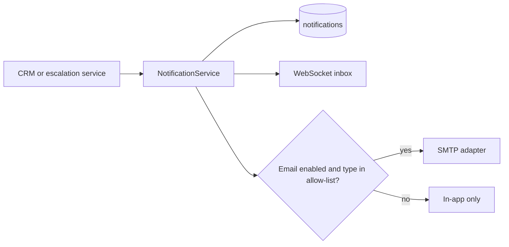

# Notifications

**Status:** Proposed.  
**Primary channel:** in-app rows in `notifications` plus a WebSocket event.  
**Email:** optional, for escalation and SLA only.  
**Mobile push:** not in the prototype. The mobile app polls `GET /api/v1/notifications` and listens on the same inbox socket when the app is open.

## Events

| type | When | Who | entity |
| --- | --- | --- | --- |
| `new_lead` | Lead created by the AI | Owner if set, otherwise all supervisors | lead |
| `followup_due` | `scheduled_at` within 15 minutes and status `scheduled` | Assignee, or supervisors if unassigned | follow_up |
| `high_priority_customer` | Urgent escalation opened, or staff set estimated value at or above `HIGH_VALUE_LEAD` | Supervisors | escalation or lead |
| `ai_escalation` | Any escalation opened by AI or policy | Supervisors for high and urgent. All agents see medium and low in the queue but get a notification only if they are on duty flag — **simplification:** notify all users with `escalation.read` for medium and low as an unread badge, not an email | escalation |
| `conversation_assigned` | Takeover or assign | The assignee | conversation |
| `task_assigned` | `assigned_user_id` set | That user | task |
| `sla_warning` | `now > sla_due_at` and status still active, once | Assignee or supervisors | escalation |

The "on duty" idea is omitted. Every user with the relevant permission gets an in-app row for medium and low escalations. If that is noisy in testing, the follow-up change is a per-user mute, not a new workflow engine.

## Delivery

Email allow-list: `ai_escalation` when priority is `high` or `urgent`, and `sla_warning`. Other types never send email in this design.

`SMTP` unset means skip email and log `delivery=skipped_unconfigured`. The in-app insert still commits.

## Mobile and web

Both clients:

- Badge count from unread notifications.
- List screen.
- Tap navigates to the entity route (`/escalations/{id}`, `/leads/{id}`, `/conversations/{id}`, `/tasks/{id}`, `/followups/{id}`).

The web app also plays no sound by default.

## Follow-up scanner

Once a minute, one function `scan_due_followups` selects follow-ups with status `scheduled`, `scheduled_at <= now + 15 minutes`, and no existing `followup_due` notification for that id. It inserts notifications and, if `scheduled_at < now - 1 hour` and still scheduled, sets status `missed` and writes nothing customer-visible.

The scanner runs in the API process. Deployment of two API replicas is unsupported until the scanner moves to a single worker. See the deployment document.

## Failure

Notification insert failure rolls back with the business action that caused it when they share a transaction (lead create, escalation open). Scanner failures are logged and retried on the next minute. They do not block chat.
