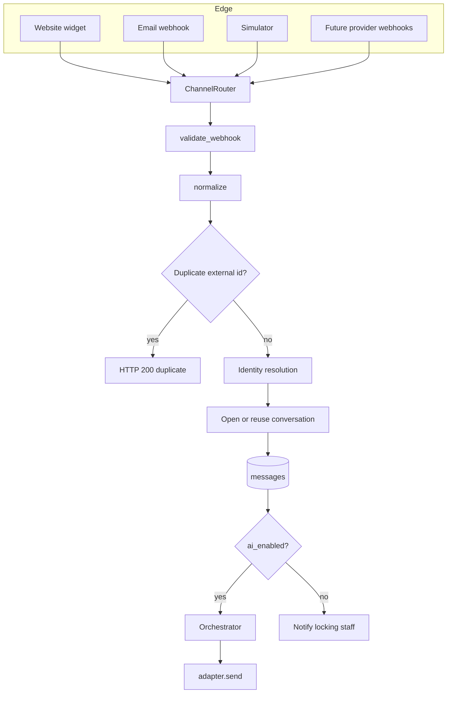

# Omnichannel Integration

**Status:** Proposed. No channel code exists.  
**Principle:** the CRM and the AI agent accept only `CanonicalMessage`. Channel SDKs stay inside adapters.

## 1. Adapter interface

```python
class ChannelAdapter(Protocol):
    code: str

    def validate_webhook(self, headers: dict, body: bytes) -> None:
        """Raise WebhookRejected on a bad signature. No-op for website chat."""

    def normalize_inbound(self, payload: dict) -> CanonicalMessage:
        """Map a provider payload into the canonical model."""

    def external_identity(self, message: CanonicalMessage) -> str:
        """Stable customer handle on this channel."""

    def send(self, message: OutboundRequest) -> str:
        """Send text. Return the provider message id."""
```

`receive` in the requirements is the HTTP or WebSocket handler in `api/v1`, which calls `validate_webhook` then `normalize_inbound`. The adapter does not own the socket loop.

Implemented classes:

| Class | Transport in this project |
| --- | --- |
| `WebsiteChatAdapter` | First real transport. WebSocket plus `POST /api/v1/widget/messages` |
| `EmailAdapter` | Second transport. Inbound HMAC webhook, outbound SMTP |
| `WhatsAppAdapter` | Normalizes a Cloud-API-shaped JSON object. Send raises `ChannelNotConnected` unless `WHATSAPP_TOKEN` is set |
| `FacebookAdapter` | Same pattern for Messenger payloads |
| `InstagramAdapter` | Same pattern for Instagram messaging payloads |
| `VoiceAdapter` | Accepts a transcript. Does not place calls |

`ChannelNotConnected` is a successful defensive result: the message is stored, staff see it, the customer is not told that an external send succeeded.

## 2. Canonical message

```json
{
  "message_id": "uuid-assigned-by-crm",
  "channel": "website",
  "external_message_id": "provider-id-or-null",
  "external_identity": "visitor-session-or-phone-or-email",
  "customer_id": "uuid-or-null-until-resolved",
  "conversation_id": "uuid-or-null-until-opened",
  "direction": "inbound",
  "message_type": "text",
  "content": "I am interested in the premium package",
  "timestamp": "2026-10-05T15:00:00Z",
  "metadata": { "simulated": false }
}
```

`customer_id` and `conversation_id` are filled by `IdentityService` and `ConversationService` immediately after normalize, before the AI runs. Adapters leave them null.

Outbound uses the same shape with `direction=outbound` and `sender_type` stored on the message row rather than inside the adapter.

## 3. Pipeline



The router is the only caller of adapters' normalize methods. Adding Instagram means a new class and a route registration, not a change to `LeadService` or the planner.

## 4. Website chat

1. The widget calls `POST /api/v1/widget/session` with `X-Widget-Key`.
2. The server creates a provisional customer, a `website` contact whose `external_identity` is `visitor_session_id`, and an open conversation.
3. The browser opens `/api/v1/ws/widget`.
4. Each customer text is an inbound canonical message with `external_message_id` equal to a UUID the widget generates, so retries of the same POST do not double-insert.
5. `WebsiteChatAdapter.send` pushes a WebSocket event. If the socket is down, the message remains in PostgreSQL and the widget loads it with GET.

This channel is enough to demonstrate the full AI path.

## 5. Email

Development uses [Mailpit](https://github.com/axllent/mailpit) or any SMTP catcher. The inbound side of the prototype is not a full IMAP client. A small parser accepts:

```json
{
  "from": "amina@example.com",
  "to": "support@northline.example",
  "message_id": "<provider-id>",
  "subject": "Premium package",
  "text": "Can someone call me tomorrow?"
}
```

`external_identity` is the lower-cased `from` address. `content` is `subject` plus text body, trimmed to 4000 characters. Attachments are ignored in the MVP and noted in `metadata.attachments_skipped`.

Outbound uses SMTP settings `SMTP_HOST`, `SMTP_PORT`, `SMTP_USER`, `SMTP_PASSWORD`, `SMTP_FROM`. If SMTP is unset, `send` stores the message and marks `metadata.delivery=skipped_unconfigured`. Staff can still see the outbound text. The UI must show that badge so a demo does not pretend the mail left the building.

Signature: HMAC-SHA256 of the raw body, header `X-Channel-Signature`.

## 6. WhatsApp, Facebook, Instagram

These adapters are real classes with:

- A Pydantic model of the few fields the prototype needs: sender id, message id, text, timestamp.
- `normalize_inbound` implemented against that model.
- `validate_webhook` checking `X-Hub-Signature-256` when `META_APP_SECRET` is set.
- `send` calling the provider HTTP API only when the corresponding token environment variable is non-empty.

Until those variables exist, the **simulator** is how the team demonstrates a Facebook-shaped payload. The simulator sets `metadata.simulated=true`. Analytics can filter simulated traffic with `metadata.simulated is false`. Demo data should say when it is simulated.

The project does not ship Meta app review, WhatsApp templates, or a Facebook page. Treating those as done would be false.

| Variable | Adapter |
| --- | --- |
| `WHATSAPP_TOKEN`, `WHATSAPP_PHONE_ID` | WhatsApp send |
| `FACEBOOK_PAGE_TOKEN` | Facebook send |
| `INSTAGRAM_TOKEN` | Instagram send |
| `META_APP_SECRET` | Signature check for all three |

## 7. Voice

`VoiceAdapter.normalize_inbound` expects:

```json
{ "call_id": "abc", "from": "+94770000000", "transcript": "I need the premium package" }
```

`external_identity` is the phone number. `message_type` is `audio` only if a recording URL is present; the MVP stores the transcript as `text` and puts the URL in metadata if a future provider sends one. Speech-to-text is outside the system. A teammate can paste a transcript through the simulator on channel `voice` during the demo.

`send` for voice stores the agent text as the call-back script. It does not dial. `VOICE_PROVIDER_URL` empty means not connected.

## 8. Identity hook

`getCustomerIdentity` in the requirements is `IdentityService.resolve`, called by the router with `adapter.code` and `external_identity`. Adapters do not query customers themselves. Rules are in the AI architecture section on identification.

Cross-channel example: a website visitor later emails from the same address they typed in chat. The email contact matches `primary_email`. The service attaches the email identity as unverified and links the new conversation to the same customer. The journey event is `channel_switch`. Mutating AI tools stay disabled until the match is verified or the customer confirms in the reply and staff, or a second independent match, sets `is_verified`.

## 9. Webhooks, retries, duplicates, failure

| Concern | Behavior |
| --- | --- |
| Signature failure | HTTP 401. Nothing stored |
| Duplicate `(channel_id, external_message_id)` | HTTP 200 `{ "duplicate": true }`. No second AI turn |
| Database down | HTTP 503. Provider retries. Nothing was partially committed because the insert is one transaction |
| AI failure after insert | HTTP 200 to the provider. The message is safe. The turn escalates or records `failed`. The provider must not retry the AI |
| Send failure | Outbound row kept. `metadata.delivery=failed` and `delivery_error` set. One retry after 30 seconds in-process. Then a task `Delivery failed` for staff |
| Poison payload | `normalize_inbound` raises `VALIDATION_ERROR`. HTTP 400. No retry loop inside our service |

Idempotency of CRM tools is separate and keyed by the internal message id. A provider retry that we correctly detect as duplicate never reaches the tool executor.

## 10. What the rest of the app sees

Services and the planner see channel only as a code on the conversation and the message. They do not import WhatsApp types. Tests can pass a `CanonicalMessage` through `ChannelRouter.ingest_canonical` for every scenario in the demo document.
